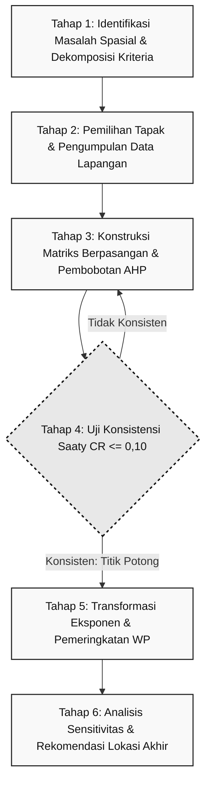

# C. METODOLOGI PENELITIAN

Bagian ini menguraikan metodologi penelitian untuk menentukan lokasi strategis gerai ritel perhiasan emas. Pendekatan hibrida mengintegrasikan keunggulan pembobotan kriteria Analytic Hierarchy Process dengan ketahanan algoritma Weighted Product dalam merangking alternatif lokasi. Uraian metodologis disajikan secara berurutan mencakup tahapan pelaksanaan riset, spesifikasi objek dan kandidat tapak di wilayah Daerah Istimewa Yogyakarta, instrumen penghimpunan data kriteria, formulasi algoritma matematis sekuensial, serta prosedur pengujian konsistensi logis dan stabilitas keputusan. Kerangka ini memastikan transparansi analisis.

## C.1. Tahapan dan Alur Penelitian

Penyelidikan ilmiah ini dijalankan melalui kerangka kerja terstruktur untuk menyelesaikan kompromi multiatribut penentuan tapak bisnis secara rasional, objektif, dan dapat dipertanggungjawabkan secara komputasi. Keseluruhan alur kerja operasional penelitian dibagi ke dalam enam tahapan utama yang saling berkesinambungan. Sistematika ini memandu jalannya riset.

Tahap pertama berfokus pada identifikasi persoalan spasial industri perhiasan emas bernilai ekonomi tinggi. Peneliti merumuskan sasaran keputusan, mengidentifikasi faktor penentu keberhasilan lokasi ritel berdasarkan kajian literatur serta regulasi tata ruang wilayah, lalu menyusun dekomposisi struktur hierarki kriteria evaluasi secara sistematis. Tahap ini meletakkan fondasi model.

Tahap kedua memusatkan perhatian pada seleksi tapak dan akuisisi data empiris lapangan. Peneliti menetapkan lima kandidat ruko komersial di wilayah Daerah Istimewa Yogyakarta yang merepresentasikan keragaman karakteristik zonasi bisnis perkotaan. Penghimpunan data kriteria dilaksanakan melalui survei observasi lapangan, wawancara bersama pemilik properti, serta kompilasi data pasar komersial. Data ini dihimpun secara cermat.

Tahap ketiga menerapkan instrumen Analytic Hierarchy Process untuk menentukan bobot prioritas kriteria. Peneliti mengonstruksi matriks perbandingan berpasangan antarkriteria berskala Saaty, menghitung vektor eigen normalisasi untuk menyintesis bobot kepentingan, serta menguji konsistensi logis matriks melalui rasio konsistensi Saaty. Pengujian konsistensi ini menjadi tahapan yang menentukan validitas seluruh proses pembobotan. Apabila rasio konsistensi melebihi ambang batas toleransi 0,10, matriks perbandingan berpasangan harus ditinjau ulang bersama pakar guna menjamin koherensi logika penilaian. Keabsahan bobot menjadi prasyarat mutlak.

Tahap keempat memberlakukan titik potong metodologis untuk membatasi ruang lingkup operasional metode AHP. Penggunaan metode AHP dihentikan secara tegas tepat setelah vektor bobot kriteria terbukti konsisten, sehingga instrumen tersebut tidak digunakan untuk menilai alternatif lokasi secara berpasangan. Vektor bobot prioritas yang dihasilkan langsung ditransformasikan menjadi eksponen pemangkatan dalam algoritma pemeringkatan alternatif. Isolasi ini mencegah distorsi peringkat.

Tahap kelima mengeksekusi komputasi matematis metode Weighted Product. Data kinerja riil dari setiap kandidat tapak dipangkatkan dengan bobot kriteria yang bersesuaian guna menghitung nilai preferensi absolut, lalu dinormalisasi secara proporsional untuk memperoleh nilai preferensi relatif seluruh alternatif. Prosedur ini menjamin objektivitas evaluasi.

Tahap keenam menghasilkan sintesis rekomendasi akhir lokasi gerai emas yang paling optimal. Peneliti menetapkan urutan pemeringkatan tapak berdasarkan besaran nilai preferensi relatif, kemudian menguji stabilitas urutan keputusan melalui analisis sensitivitas terhadap dinamika fluktuasi bobot parameter. Rekomendasi ini bersifat definitif.

Visualisasi kerangka tahapan operasional riset beserta titik peralihan komputasi disajikan pada Gambar 1.

Gambar 1. Alur Tahapan Penelitian Hibrida AHP-WP Penentuan Lokasi Ritel Emas

## C.2. Objek dan Lokasi Penelitian

Objek penelitian berfokus pada penentuan lokasi fisik bagi gerai ritel perhiasan emas bernilai tinggi. Karakteristik khusus komoditas emas menuntut perlindungan aset berstandar tinggi, kemudahan renovasi gedung untuk brankas tonase berat, serta keberadaan konsumen berdaya beli kuat pada koridor yang mudah diakses. Penelitian menetapkan lima kandidat tapak di wilayah Daerah Istimewa Yogyakarta sebagai alternatif lokasi evaluasi. Pemilihan kelima lokasi tersebut mencakup spektrum zonasi komersial yang bervariasi, meliputi ruko komersial di koridor arteri perkotaan serta ruang usaha di dalam pusat perbelanjaan modern.

Kandidat tapak pertama ($A_1$) terletak di kawasan Sinduadi, Jalan Umbul Permai, Kabupaten Sleman. Properti komersial mandiri ini memiliki luas bangunan 210 meter persegi dengan lebar muka 12 meter dan pasokan daya listrik 7.000 Watt. Kawasan ini berkembang pesat sebagai koridor hunian kelas menengah ke atas dengan keunggulan berupa keleluasaan renovasi struktur fondasi gedung untuk penanaman brankas baja berat. Tapak ini menyajikan fleksibilitas tinggi.

Kandidat tapak kedua ($A_2$) menempati koridor komersial Jalan Magelang Kilometer 5, Kabupaten Sleman. Properti ini berwujud ruko dua lantai pada jalur arteri primer regional yang berada sangat dekat dengan pusat perbelanjaan modern Jogja City Mall. Koridor arteri ini memiliki arus lalu lintas harian yang sangat padat serta visibilitas tinggi, namun tingkat persaingan bisnis di kawasan sekitarnya tergolong cukup ketat. Aksesibilitas tapak ini sangat baik.

Kandidat tapak ketiga ($A_3$) berada di kawasan Babarsari, Caturtunggal, Kabupaten Sleman. Bangunan ruko dua lantai dengan lebar muka 4,2 meter ini berlokasi di tengah konsentrasi hunian mahasiswa dan berbagai kampus perguruan tinggi swasta terkemuka. Kepadatan mobilitas penduduk kawasan ini sangat tinggi, tetapi profil daya beli masyarakat sekitar untuk transaksi perhiasan emas bernilai tinggi relatif terbatas. Kondisi ini menjadi batasan ekonomi.

Kandidat tapak keempat ($A_4$) bertempat di koridor komersial Jalan Taman Siswa, Mergangsan, Kota Yogyakarta. Properti komersial dua lantai ini menempati posisi sudut persimpangan jalan dengan lebar muka mencapai 10 meter. Posisi sudut tersebut menyediakan aksesibilitas dua arah yang sangat strategis, ketersediaan ruang parkir yang memadai, serta paparan visual koridor yang terbuka luas bagi pengguna jalan. Potensi pemasarannya sangat menjanjikan.

Kandidat tapak kelima ($A_5$) menempati unit ruang usaha komersial di dalam pusat perbelanjaan Malioboro Mall, Kota Yogyakarta. Ruang ritel seluas 54 meter persegi ini terletak pada lantai utama pusat niaga di jantung destinasi pariwisata provinsi. Kawasan Malioboro dikelilingi oleh klaster aglomerasi pertokoan emas historis dan didukung oleh sistem pengamanan terpadu pengelola gedung selama 24 jam penuh. Keamanan lokasi ini terjamin.

Penyebaran kelima kandidat lokasi tersebut menyajikan perbandingan empiris yang komprehensif antara kawasan hunian berkembang, koridor niaga arteri, kawasan pendidikan, koridor perkotaan sentral, serta pusat perbelanjaan modern. Variasi ini memperkaya analisis keputusan.

## C.3. Karakteristik Data dan Kriteria Keputusan

Penelitian menghimpun data primer dan data sekunder guna menjamin keandalan parameter evaluasi model. Data primer diperoleh melalui observasi langsung pada setiap kandidat tapak, pengukuran lebar koridor, wawancara mendalam bersama pemilik gedung mengenai fleksibilitas struktur, serta pengisian kuesioner perbandingan berpasangan oleh praktisi bisnis ritel perhiasan. Data sekunder dihimpun dari dokumen tarif sewa komersial tahunan, publikasi statistik keamanan wilayah sekitar, serta pemetaan spasial gerai pesaing. Sumber data ini saling melengkapi.

Penelitian menetapkan enam kriteria keputusan yang mencerminkan pertimbangan finansial, teknis keamanan, dan potensi pasar ritel perhiasan emas. Kriteria tersebut dikelompokkan ke dalam dua kategori sifat atribut yang berbeda implikasi perhitungannya.

Kriteria pertama, biaya beban properti ($C_1$), tergolong sebagai atribut biaya dalam pemodelan keputusan ini. Parameter ini merepresentasikan akumulasi tarif sewa tahunan gedung dan estimasi biaya operasional dasar dalam satuan rasio riil juta rupiah per tahun. Nilai biaya yang semakin rendah menghasilkan nilai preferensi yang semakin tinggi bagi kelayakan investasi bisnis ritel. Efisiensi biaya menjadi sasaran utama.

Lima parameter lainnya berfungsi sebagai atribut keuntungan dengan peningkatan skor yang menandakan kondisi tapak yang semakin menguntungkan bagi kelangsungan usaha. Kelima kriteria keuntungan tersebut dikuantifikasi menggunakan skala pengukuran ordinal bernilai 1 sampai 5 berdasarkan pedoman rubrik terstandarisasi.

Kriteria keamanan eksternal kawasan ($C_2$) mengevaluasi keandalan proteksi di luar kendali internal toko, mencakup jarak markas kepolisian terdekat, frekuensi patroli keamanan berkala, serta riwayat kriminalitas lingkungan sekitar tapak. Aspek ini melindungi keselamatan toko.

Kriteria potensi daya beli lingkungan ($C_3$) mengukur kualitas arus massa konsumen yang melintasi koridor lokasi tapak. Evaluasi ini membedakan kepadatan massa biasa dari konsentrasi pembeli yang memiliki kapasitas finansial nyata untuk membeli perhiasan emas. Parameter ini menentukan perputaran modal.

Kriteria visibilitas lokasi ($C_4$) menilai tingkat keterlihatan fisik gerai ritel dari koridor jalan raya dan jalur pejalan kaki. Keterlihatan fasad gedung berkontribusi langsung dalam menarik perhatian konsumen sekaligus mempermudah pengawasan visual alami dari jalan raya. Eksposur visual memperkuat pengenalan merek.

Kriteria fleksibilitas perombakan struktur gedung ($C_5$) mengukur keleluasaan izin modifikasi fisik bangunan dari pemilik properti. Modifikasi ini mencakup pengeboran lantai fondasi untuk penempatan brankas baja tonase berat, penanaman sistem jangkar pengaman, serta penyekatan kaca tahan peluru. Izin ini mutlak diperlukan.

Kriteria aglomerasi sentra emas ($C_6$) mengukur kerapatan toko emas kompetitor di kawasan komersial sekitar tapak. Konsentrasi gerai ritel sejenis menciptakan efek klaster niaga positif yang memperkuat identitas wilayah sebagai destinasi utama belanja perhiasan. Aglomerasi memperluas pasar bersama.

Rangkuman karakteristik data, sifat atribut, serta rentang skala pengukuran kriteria disajikan pada Tabel 1.

Tabel 1. Karakteristik Data dan Klasifikasi Atribut Kriteria Evaluasi

| Kode | Kriteria Keputusan | Sifat Atribut | Satuan Pengukuran | Skala Data | Rentang Nilai |
| :---: | :--- | :---: | :---: | :---: | :---: |
| $C_1$ | Biaya Beban Properti | Biaya | Juta Rupiah per Tahun | Rasio Riil | 120,00 - 346,32 |
| $C_2$ | Keamanan Kawasan | Keuntungan | Tingkat Keamanan | Ordinal | Skala 1 - 5 |
| $C_3$ | Potensi Daya Beli | Keuntungan | Kapasitas Finansial | Ordinal | Skala 1 - 5 |
| $C_4$ | Visibilitas Lokasi | Keuntungan | Keterbukaan Visual | Ordinal | Skala 1 - 5 |
| $C_5$ | Fleksibilitas Renovasi | Keuntungan | Kebebasan Izin | Ordinal | Skala 1 - 5 |
| $C_6$ | Aglomerasi Sentra Emas | Keuntungan | Kepadatan Klaster | Ordinal | Skala 1 - 5 |

Perpaduan data kuantitatif kontinu pada kriteria biaya dan data kualitatif diskret pada lima kriteria lainnya dapat diolah langsung oleh metode Weighted Product tanpa mewajibkan tahapan penyeragaman satuan matriks keputusan di awal komputasi. Fleksibilitas ini mempercepat proses komputasi data.

## C.4. Prosedur Algoritma Integrasi AHP-WP

Integrasi metode AHP dan Weighted Product disusun secara sekuensial dengan pembagian wewenang algoritma yang tegas. Metode AHP difungsikan khusus untuk mengolah perbandingan berpasangan kriteria, sedangkan algoritma Weighted Product bertugas mengeksekusi pemeringkatan seluruh alternatif lokasi. Prosedur komputasi hibrida ini dirinci ke dalam sembilan langkah sistematis.

Langkah pertama mengonstruksi matriks perbandingan berpasangan kriteria berordo $n \times n$. Preferensi pertimbangan pakar dirangkum menggunakan skala Saaty bernilai 1 sampai 9. Struktur perbandingan dinyatakan dalam matriks $A = [a_{jk}]_{n \times n}$ yang memenuhi kaidah resiprokal $a_{kj} = 1 / a_{jk}$ dan diagonal bernilai 1. Matriks ini mendokumentasikan preferensi awal.

Langkah kedua menormalisasi matriks perbandingan berpasangan kriteria dengan membagi setiap nilai sel terhadap total kolom yang bersesuaian. Normalisasi kolom tersebut dirumuskan melalui hubungan matematis berikut.

$$r_{jk} = \frac{a_{jk}}{\sum_{p=1}^n a_{pk}}$$

Langkah ketiga menyintesis vektor bobot prioritas kriteria $w_j$ melalui perhitungan rata-rata baris matriks ternormalisasi. Perhitungan sintesis bobot tersebut dirumuskan melalui persamaan berikut.

$$w_j = \frac{1}{n} \sum_{k=1}^n r_{jk}$$

Hasil perhitungan menghasilkan bobot kepentingan relatif antarkriteria yang terdistribusi secara proporsional dengan jumlah akumulasi nilai tepat sebesar 1. Bobot ini mencerminkan prioritas relatif.

Langkah keempat menguji konsistensi matriks perbandingan berpasangan secara matematis. Evaluasi konsistensi memanfaatkan parameter nilai eigen maksimum ($\lambda_{\max}$), indeks konsistensi ($CI$), dan rasio konsistensi Saaty ($CR$). Tahapan ini memastikan pertimbangan pakar bersifat logis dan tidak bertentangan. Pengujian ini menjamin koherensi logika.

Langkah kelima memberlakukan titik potong metodologis untuk menghentikan operasional instrumen AHP tepat setelah vektor bobot kriteria terbukti konsisten. Prosedur penilaian berpasangan antaralternatif pada level terbawah ditiadakan untuk menghindarkan sistem keputusan dari ancaman distorsi pergeseran peringkat. Titik potong ini menjaga stabilitas.

Langkah keenam menyesuaikan tanda eksponensial bobot $W_j$ untuk algoritma Weighted Product. Nilai bobot kriteria AHP diubah tandanya menjadi eksponen negatif untuk kriteria biaya dan eksponen positif untuk kriteria keuntungan melalui aturan berikut.

$$W_j = -w_j \quad (\text{untuk atribut biaya}), \qquad W_j = +w_j \quad (\text{untuk atribut keuntungan})$$

Langkah ketujuh menyusun matriks keputusan kinerja alternatif lokasi berukuran $m \times n$. Matriks $X = [x_{ij}]_{m \times n}$ merangkum nilai kinerja empiris dari $m$ alternatif lokasi terhadap $n$ kriteria keputusan yang dievaluasi dalam penelitian ini. Data ini siap diproses lebih lanjut.

Langkah kedelapan menghitung vektor preferensi absolut $S_i$ untuk setiap kandidat lokasi tapak. Nilai preferensi absolut diperoleh melalui perkalian seluruh elemen baris alternatif yang dipangkatkan terhadap eksponen bobot kriteria melalui formulasi berikut.

$$S_i = \prod_{j=1}^n (x_{ij})^{W_j}$$

Operasi perkalian eksponensial ini mengevaluasi kinerja masing-masing tapak secara mandiri tanpa terpengaruh oleh sebaran nilai kandidat lain dalam matriks keputusan. Kemandirian ini menjaga independensi skor.

Langkah kesembilan menghitung vektor preferensi relatif $V_i$ untuk merangking seluruh kandidat tapak. Nilai preferensi relatif diperoleh dengan membagi nilai preferensi absolut suatu lokasi terhadap total nilai seluruh lokasi melalui rumusan berikut.

$$V_i = \frac{S_i}{\sum_{k=1}^m S_k}$$

Kandidat tapak dengan nilai $V_i$ tertinggi ditetapkan sebagai prioritas utama rekomendasi pendirian gerai ritel perhiasan emas. Hasil ini menjadi rujukan investasi.

## C.5. Metode Evaluasi dan Pengujian Konsistensi

Validasi metodologis dalam penelitian ini diarahkan pada dua dimensi utama: pengujian konsistensi logika pembobotan dan verifikasi ketahanan urutan peringkat alternatif terhadap anomali pembalikan peringkat.

Dimensi pertama mengevaluasi konsistensi pertimbangan preferensi pakar melalui perhitungan rasio konsistensi Saaty. Nilai eigen maksimum diestimasi dengan mengalikan matriks awal terhadap vektor bobot kriteria, kemudian merata-ratakan rasio konsistensi elemen melalui persamaan berikut.

$$\lambda_{\max} = \frac{1}{n} \sum_{j=1}^n \frac{(A \cdot w)_j}{w_j}$$

Tingkat penyimpangan konsistensi matriks perbandingan diukur melalui indeks konsistensi ($CI$) yang dirumuskan melalui hubungan matematis berikut.

$$CI = \frac{\lambda_{\max} - n}{n - 1}$$

Rasio konsistensi ($CR$) dihitung dengan membagi nilai indeks konsistensi terhadap indeks acak (*Random Index* / $RI$) berskala standar Saaty sesuai dengan ukuran matriks melalui persamaan berikut.

$$CR = \frac{CI}{RI}$$

Matriks perbandingan dinyatakan konsisten secara memuaskan apabila nilai rasio konsistensi tidak melampaui nilai ambang batas 0,10 ($CR \le 0{,}10$). Pengujian ini menjamin keabsahan bobot.

Dimensi kedua menguji stabilitas urutan pemeringkatan alternatif terhadap kerentanan fenomena pembalikan peringkat (*rank reversal*). Pada metode aditif konvensional, penambahan atau penghapusan alternatif non-optimal dapat mengubah urutan peringkat relatif antara alternatif-alternatif yang ada. Gejala ini melanggar aksioma dasar independensi alternatif yang tidak relevan (*Independence of Irrelevant Alternatives*). Masalah ini harus dihindari.

Algoritma Weighted Product menangkal kelemahan tersebut melalui mekanisme perkalian eksponensial yang bersifat multiplikatif. Rasio preferensi antara dua alternatif tertentu, misalnya kandidat $A_a$ dan kandidat $A_b$, murni bergantung pada perbandingan skor kedua alternatif tersebut tanpa dipengaruhi keberadaan kandidat lain melalui pembuktian matematis berikut.

$$\frac{S_a}{S_b} = \prod_{j=1}^n \left( \frac{x_{aj}}{x_{bj}} \right)^{W_j}$$

Persamaan tersebut memperlihatkan bahwa rasio preferensi absolut antara $A_a$ dan $A_b$ selalu bernilai invarian terhadap ada atau tiadanya alternatif tambahan $A_c$ di dalam himpunan tapak. Ketahanan matematis ini memastikan bahwa rekomendasi tapak gerai emas yang terpilih bersifat stabil, kokoh, dan konsisten.
