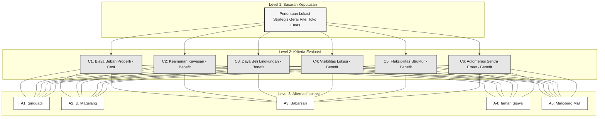
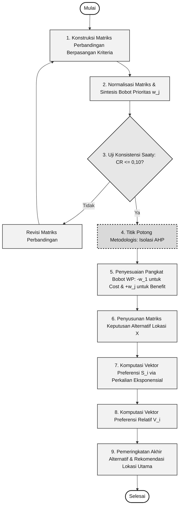
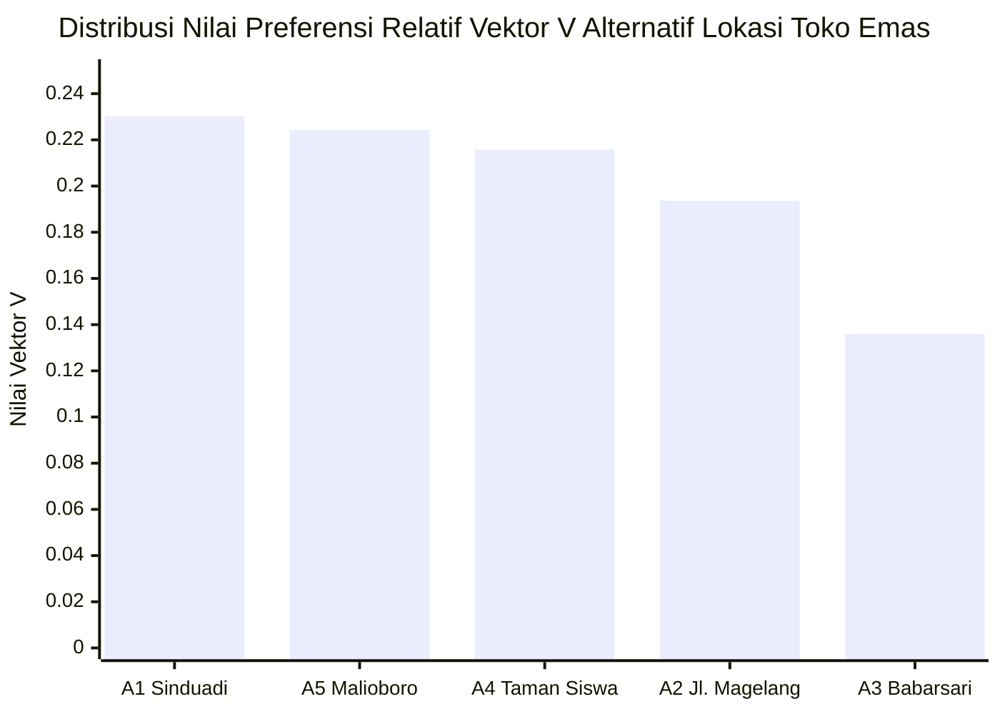

# B. LANDASAN TEORI

## B.3. Penggunaan Gambar

Visualisasi grafis dalam penelitian ini digunakan untuk memperjelas dekomposisi masalah keputusan dan alur komputasi algoritma hibrida, sekaligus menampilkan distribusi hasil pemeringkatan akhir secara transparan. Berdasarkan pedoman template penulisan jurnal ilmiah, setiap gambar disajikan dalam format monokromatis dengan pembeda arsiran yang kontras agar tetap terbaca jelas saat dicetak tanpa warna. Nomor dan judul gambar ditempatkan tepat di bagian bawah gambar pada posisi rata tengah dengan format Title Case. Setiap gambar dipanggil terlebih dahulu di dalam teks paragraf sebelum ilustrasinya disajikan untuk memandu pemahaman pembaca. Hal ini menjaga keterbacaan naskah.

### B.3.1. Struktur Hierarki Keputusan Penentuan Lokasi Ritel Emas

Dekomposisi permasalahan multikriteria penentuan lokasi strategis gerai ritel perhiasan emas dirumuskan ke dalam model hierarki bertingkat. Struktur dekomposisi masalah dan pemetaan relasi antarelemen tersebut disajikan pada Gambar 1.

Gambar 1. Struktur Hierarki Keputusan Penentuan Lokasi Ritel Perhiasan Emas
> *Format cetak: Ukuran teks judul 10 pt, posisi rata tengah, format Title Case.*

Struktur hierarki pada Gambar 1 membagi domain keputusan ke dalam tiga level sistematis untuk mereduksi kompleksitas evaluasi lokasi ritel. Level 1 menjadi fokus sasaran utama, yaitu penentuan lokasi gerai ritel perhiasan emas yang paling optimal. Level 2 memuat enam kriteria evaluasi yang mengintegrasikan aspek finansial dan keamanan fisik, beserta parameter tata ruang komersial. Kriteria biaya sewa ($C_1$) bertindak sebagai atribut biaya, sedangkan lima kriteria lainnya ($C_2$ hingga $C_6$) merupakan atribut keuntungan. Level 3 berisi lima kandidat lokasi di Daerah Istimewa Yogyakarta yang dievaluasi secara menyeluruh terhadap seluruh kriteria tersebut. Dalam konteks pemodelan sistem keputusan, Gambar 1 berfungsi memetakan abstraksi persoalan penentuan lokasi ritel di dunia nyata ke dalam struktur ruang vektor multikriteria yang dapat diukur dan dianalisis secara matematis. Pemetaan ini memperjelas kedudukan kriteria.

### B.3.2. Diagram Alir Komputasi Terintegrasi Algoritma Hibrida AHP-WP

Integrasi metode AHP dan Weighted Product disusun secara sekuensial dengan batas komputasi yang tegas antara fase pembobotan dan fase pemeringkatan. Tahapan prosedur algoritma matematis serta titik peralihan antarmetode dipetakan secara terstruktur pada Gambar 2.

Gambar 2. Diagram Alir Komputasi Terintegrasi Algoritma Hibrida AHP-WP
> *Format cetak: Ukuran teks judul 10 pt, posisi rata tengah, format Title Case.*

Diagram alir pada Gambar 2 memperjelas fungsi strategis dari titik potong metodologis yang memisahkan peran AHP pada fase penentuan bobot prioritas kriteria dari peran Weighted Product pada fase pemeringkatan akhir alternatif. Pada fase pertama, instrumen AHP hanya difungsikan untuk membangun matriks perbandingan berpasangan dan menyintesis vektor bobot prioritas kriteria. Matriks tersebut wajib melalui gerbang pengujian rasio konsistensi Saaty. Ketika nilai rasio konsistensi telah memenuhi batas kelayakan ($CR = 0{,}0677$), penggunaan metode AHP langsung dihentikan guna mencegah munculnya anomali pembalikan peringkat. Pada fase kedua, bobot yang telah teruji konsistensinya ditransformasikan menjadi eksponen pemangkatan dalam algoritma Weighted Product, dengan nilai negatif untuk kriteria biaya dan nilai positif untuk kriteria keuntungan. Skema perkalian eksponensial ini mengamankan evaluasi alternatif dari interdependensi skor kelompok, sehingga proses pengambilan keputusan dapat berjalan secara konsisten. Hal ini menjamin stabilitas evaluasi.

### B.3.3. Grafik Perbandingan Nilai Preferensi Vektor S dan Vektor V

Hasil akhir perhitungan komputasi Weighted Product menghasilkan dua parameter evaluasi, yaitu Vektor S sebagai preferensi absolut dan Vektor V sebagai preferensi relatif. Distribusi nilai preferensi kelima alternatif lokasi disajikan pada Gambar 3.

Gambar 3. Grafik Perbandingan Nilai Preferensi Relatif Vektor V Alternatif Lokasi
> *Format cetak: Ukuran teks judul 10 pt, posisi rata tengah, format Title Case.*

Visualisasi pada Gambar 3 menunjukkan perbandingan nilai preferensi relatif Vektor V dari kelima kandidat lokasi yang diurutkan secara berjenjang. Gambar 3 mengonfirmasi bahwa kompetisi penentuan lokasi gerai emas berlangsung sangat ketat antara kandidat Sinduadi dan Malioboro Mall. Selisih preferensi antara kedua kandidat unggulan tersebut berada pada margin yang sangat tipis, yaitu sebesar 0,0059 atau 0,59%. Perbedaan tipis ini menunjukkan ketatnya persaingan lokasi.

Secara analitis, visualisasi ini membuktikan ketepatan formulasi perkalian eksponensial dalam menyelesaikan kompromi multiatribut. Lokasi Malioboro Mall itu memang memiliki keunggulan skor pada potensi daya beli serta keamanan kawasan. Namun, nilai preferensi akhirnya akan tereduksi akibat penalti eksponensial dari biaya sewa properti yang mencapai 346,32 juta rupiah. Sebaliknya, alternatif Sinduadi berhasil mengamankan peringkat pertama karena menawarkan efisiensi biaya sewa yang moderat dengan tetap mempertahankan skor maksimal pada visibilitas koridor jalan utama serta keleluasaan renovasi struktur gedung untuk penempatan brankas berat. Hasil komputasi ini memberikan landasan yang kokoh bagi pengambil keputusan untuk menetapkan lokasi Sinduadi sebagai prioritas investasi. Rekomendasi ini menjamin stabilitas keputusan.

> [!NOTE]
> **Petunjuk Teknis Pembuatan Gambar (Sesuai Template Jurnal RMSI):**
> Seluruh diagram dan grafik disajikan dalam format monokromatis hitam putih dengan arsiran kontras. Keterangan nomor dan judul gambar diletakkan rata tengah di bagian bawah gambar dengan format Title Case berukuran 10 pt. Setiap gambar wajib dirujuk terlebih dahulu di dalam teks paragraf sebelum ilustrasinya dimunculkan.
