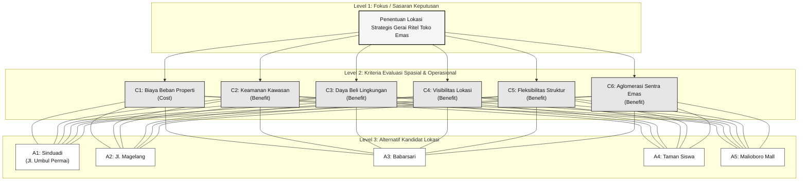
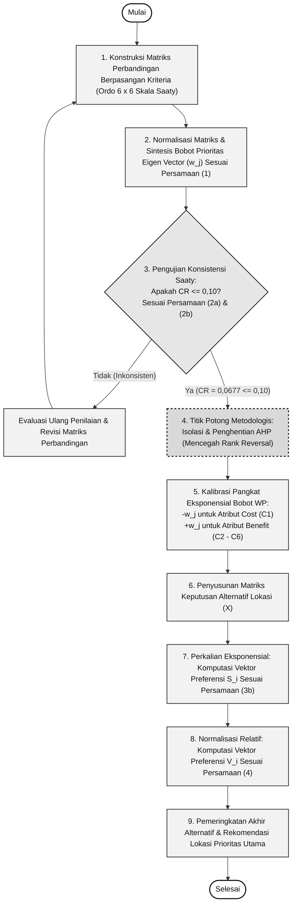
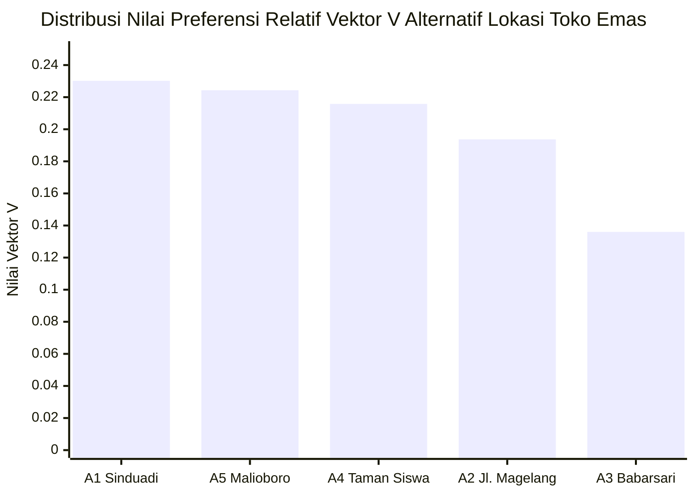

# LANDASAN TEORI

## 3. Penggunaan Gambar

> [!NOTE]
> **Catatan Strukturasi Manuskrip:** Sub-bab ini disusun untuk memenuhi petunjuk pengujian format penempatan gambar pada template jurnal RMSI. Pada perakitan naskah publikasi utuh, Gambar 1 dapat dipertahankan di Bab Landasan Teori, Gambar 2 dialokasikan ke Bab Metode Penelitian sebagai bagan alir algoritma riset, dan Gambar 3 dialokasikan ke Bab Hasil dan Pembahasan sebagai visualisasi temuan komputasi.

Visualisasi grafis dalam penelitian ini digunakan untuk memperjelas dekomposisi masalah keputusan, alur komputasi algoritma hibrida, serta perbandingan preferensi hasil pemeringkatan akhir. Berdasarkan pedoman template penulisan jurnal ilmiah, setiap gambar disajikan dalam format monokromatis (hitam, putih, dan gradasi abu-abu) dengan pembeda garis atau arsiran yang kontras agar tetap terbaca jelas saat dicetak tanpa warna. Nomor dan judul gambar ditempatkan di bawah gambar pada posisi rata tengah (*center alignment*) dengan ukuran huruf 10 pt dalam format *Title Case*. Setiap gambar dipanggil terlebih dahulu di dalam teks paragraf sebelum ilustrasinya ditampilkan, disertai pemisah jarak satu baris kosong sebelum gambar dan sesudah judul gambar.

### 3.1. Struktur Hierarki Keputusan Penentuan Lokasi Ritel Emas

Dekomposisi permasalahan multikriteria penentuan lokasi strategis gerai ritel perhiasan emas dirumuskan ke dalam model hierarki bertingkat. Struktur dekomposisi masalah dan pemetaan relasi antar elemen disajikan pada Gambar 1.



<p align="center"><b>Gambar 1. Struktur Hierarki Keputusan Penentuan Lokasi Ritel Perhiasan Emas</b><br>
<i>(Ukuran teks judul 10 pt, posisi rata tengah, format Title Case)</i></p>

Struktur hierarki pada Gambar 1 membagi domain keputusan ke dalam tiga level sistematis guna mereduksi kompleksitas evaluasi lokasi ritel. Level 1 merupakan fokus sasaran utama, yaitu penentuan lokasi gerai ritel perhiasan emas yang paling optimal. Level 2 memuat enam kriteria evaluasi yang mengintegrasikan aspek finansial, keamanan fisik, dan tata ruang komersial. Kriteria $C_1$ (biaya beban properti tahunan) bertindak sebagai atribut biaya (*cost*), sedangkan lima kriteria lainnya ($C_2$ hingga $C_6$) merupakan atribut keuntungan (*benefit*). Level 3 berisi lima kandidat lokasi di Daerah Istimewa Yogyakarta yang dievaluasi secara komprehensif terhadap seluruh kriteria. Dalam perspektif penelitian sistem informasi dan ilmu keputusan, Gambar 1 berfungsi menggantikan diagram arsitektur perangkat lunak konvensional dengan memetakan abstraksi masalah dunia nyata ke dalam struktur ruang vektor multikriteria yang terukur secara matematis.

### 3.2. Diagram Alir Komputasi Terintegrasi Algoritma Hibrida AHP-WP

Integrasi metode AHP dan Weighted Product disusun secara sekuensial dengan batas komputasi yang tegas antara fase pembobotan dan fase pemeringkatan. Tahapan prosedur algoritma matematis serta titik peralihan antar metode dipetakan secara terstruktur pada Gambar 2.



<p align="center"><b>Gambar 2. Diagram Alir Komputasi Terintegrasi Algoritma Hibrida AHP-WP</b><br>
<i>(Ukuran teks judul 10 pt, posisi rata tengah, format Title Case)</i></p>

Diagram alir pada Gambar 2 memperjelas peran strategis dari titik potong metodologis (*methodological cut-off point*). Pada fase pertama, instrumen AHP hanya difungsikan untuk membangun matriks perbandingan berpasangan dan mensintesis vektor bobot prioritas kriteria ($w_j$). Matriks wajib melalui gerbang uji rasio konsistensi Saaty ($CR \le 0{,}10$). Ketika nilai $CR$ memenuhi syarat validitas ($CR = 0{,}0677$), penggunaan metode AHP dihentikan. Prosedur pemeringkatan alternatif sengaja tidak dilanjutkan menggunakan AHP murni karena model normalisasi aditif pada AHP terbukti rentan memicu anomali pembalikan peringkat (*rank reversal*). Pada fase kedua, bobot $w_j$ yang telah teruji konsistensinya ditransformasikan menjadi eksponen pemangkatan dalam algoritma Weighted Product, dengan nilai negatif untuk kriteria biaya ($-0{,}1333$ pada $C_1$) dan nilai positif untuk kriteria keuntungan ($+0{,}0271$ hingga $+0{,}4614$ pada $C_2-C_6$). Skema perkalian eksponensial ini mengamankan evaluasi alternatif dari interdependensi skor kelompok, sehingga proses pengambilan keputusan tetap stabil dan konsisten.

### 3.3. Grafik Perbandingan Nilai Preferensi Vektor S dan Vektor V

Hasil akhir perhitungan komputasi Weighted Product menghasilkan dua parameter evaluasi, yaitu Vektor $S$ sebagai ukuran preferensi absolut hasil perkalian eksponensial dan Vektor $V$ sebagai preferensi relatif terstandarisasi. Komparasi visual distribusi nilai preferensi kelima alternatif lokasi disajikan pada Gambar 3.



```
Perbandingan Skor Preferensi Monokromatis (Format Alternatif Cetak Grayscale):
Alternatif Lokasi       Nilai Vektor S   Nilai Vektor V   Pola Distribusi Relatif (%)
-----------------------------------------------------------------------------------------
A1: Sinduadi (Terpilih)     1,6934           0,2302       [=======================] 23,02%
A5: Malioboro Mall          1,6501           0,2243       [====================== ] 22,43%
A4: Taman Siswa             1,5872           0,2158       [=====================  ] 21,58%
A2: Jl. Magelang            1,4246           0,1937       [===================    ] 19,37%
A3: Babarsari               1,0006           0,1360       [=============          ] 13,60%
-----------------------------------------------------------------------------------------
Total Akumulasi             7,3559           1,0000       100,00%
```

<p align="center"><b>Gambar 3. Grafik Perbandingan Nilai Preferensi Relatif Vektor V Alternatif Lokasi</b><br>
<i>(Ukuran teks judul 10 pt, posisi rata tengah, format Title Case)</i></p>

Visualisasi pada Gambar 3 menunjukkan perbandingan nilai preferensi relatif Vektor $V$ dari kelima kandidat lokasi yang diurutkan dari skor tertinggi hingga terendah. Gambar 3 memberikan konfirmasi visual bahwa kompetisi penentuan lokasi toko emas berlangsung sangat kompetitif, terutama antara kandidat peringkat pertama ($A_1$ Sinduadi dengan $V = 0{,}2302$) dan kandidat peringkat kedua ($A_5$ Malioboro Mall dengan $V = 0{,}2243$). Selisih preferensi antara kedua kandidat unggulan tersebut berada pada margin yang sempit, yaitu sebesar $0{,}0059$ atau $0{,}59\%$.

Secara analitis, Gambar 3 membuktikan ketepatan formulasi perkalian eksponensial dalam menyelesaikan tarik-ulur (*trade-off*) multiatribut. Meskipun alternatif $A_5$ (Malioboro Mall) memiliki keunggulan absolut pada potensi daya beli ($C_3 = 5$) dan keamanan kawasan ($C_2 = 5$), nilai preferensi akhirnya tereduksi akibat penalti eksponensial biaya sewa properti yang sangat mahal ($346{,}32$ juta rupiah pada $C_1$). Sebaliknya, alternatif $A_1$ (Sinduadi) berhasil mengamankan peringkat puncak karena menyajikan rasio biaya sewa yang efisien ($130$ juta rupiah) dengan tetap mempertahankan skor maksimal pada visibilitas koridor jalan ($C_4 = 5$) dan kebebasan modifikasi struktur fisik ruang brankas ($C_5 = 5$). Sementara itu, lokasi $A_3$ (Babarsari) berada di dasar pemeringkatan dengan selisih yang lebar ($V = 0{,}1360$), disebabkan oleh rendahnya nilai pada atribut daya beli perhiasan ($C_3 = 2$) serta minimnya efek aglomerasi sentra emas ($C_6 = 1$). Dengan demikian, visualisasi Gambar 3 memberikan landasan analitis bagi pembuat keputusan untuk menetapkan lokasi Sinduadi ($A_1$) sebagai prioritas ekspansi bisnis ritel perhiasan emas.

---

### Lampiran Catatan Teknis Penulis (Panduan Format Gambar RMSI)

> [!NOTE]
> **Syarat Teknis Pembuatan Gambar (Sesuai Template Jurnal RMSI):**
> 1. **Desain Hitam Putih (Monokrom):**  
>    Seluruh diagram dan grafik dibuat menggunakan warna hitam, putih, dan gradasi abu-abu (*grayscale*). Untuk grafik batang atau garis, gunakan pembeda berupa pola arsiran (*pattern fill* seperti titik-titik atau garis miring) atau bentuk jenis garis (*solid*, *dashed*) dan *marker* yang berbeda agar tetap terbaca jelas saat dicetak tanpa warna.
> 2. **Posisi dan Ukuran Teks:**  
>    Gambar dan keterangan judulnya diletakkan rata tengah (*center alignment*) di bagian bawah gambar dengan ukuran huruf 10 pt dan format *Title Case*.
> 3. **Sitasi di Paragraf:**  
>    Pastikan setiap gambar dipanggil terlebih dahulu di dalam teks sebelum gambarnya dimunculkan (contoh: *"Struktur dekomposisi masalah dipetakan secara hierarkis pada Gambar 1."*). Jarak baris antara gambar dengan kalimat di atas dan di bawahnya adalah 1 baris kosong.
