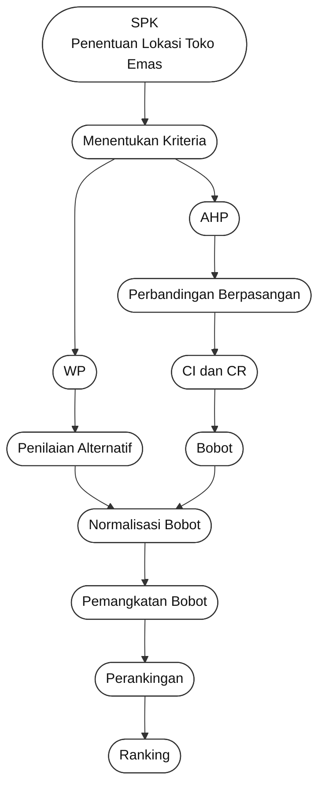
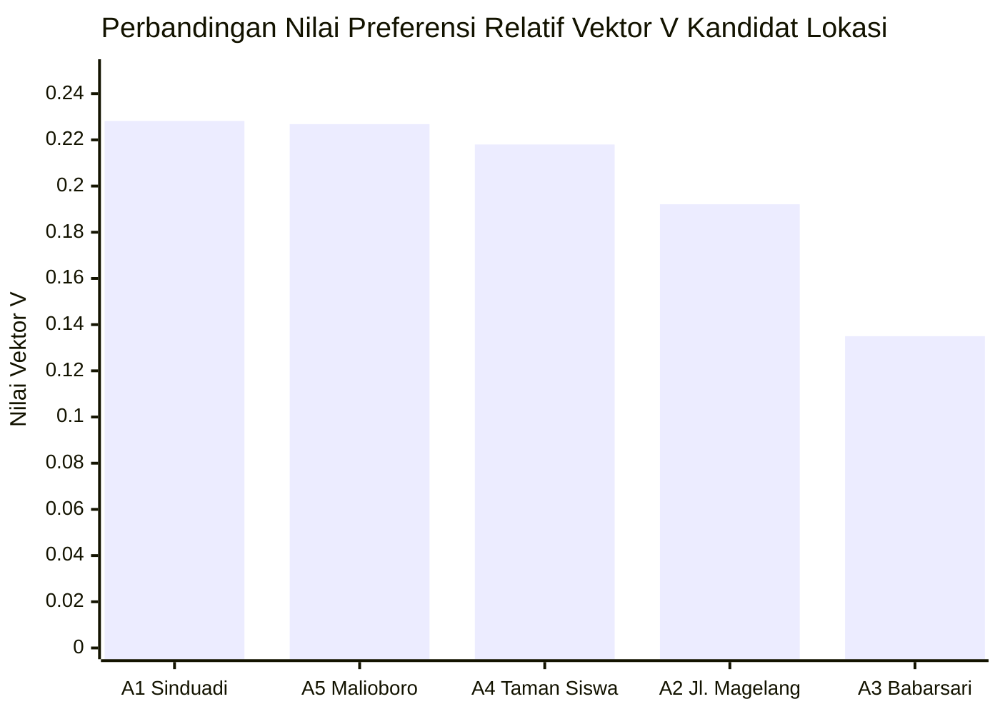

# *Integration of AHP and Weighted Product for Strategic Jewelry Retail Location Selection*
# Integrasi Metode AHP dan Weighted Product pada Penentuan Lokasi Strategis Bisnis Ritel Perhiasan

**Novelia Harlinda¹\*, Auliah Qorinaya², Muhammad Adin Dwi Ramadhan³, Muhammad Riski⁴, Rafael Aga Pratama⁵**  
¹˒²˒³˒⁴˒⁵Program Studi Pendidikan Teknik Informatika, Fakultas Teknik, Universitas Negeri Yogyakarta, Indonesia  
E-Mail: ¹noveliahrlnd@gmail.com, ²qorinayaaulia@gmail.com, ³madindwir@gmail.com, ⁴muhamaddriski098@gmail.com, ⁵rafaelagapratama0@gmail.com  
*Corresponding Author: Novelia Harlinda*

---

> **[ABSTRAK & ABSTRACT — disusun pada Langkah 4 setelah badan naskah disetujui, masing-masing maksimal 200 kata (font 9 pt) beserta minimal 5 kata kunci berurutan abjad A–Z sesuai template MALCOM.]**

---

## 1. PENDAHULUAN

Harga emas mencetak rekor tertinggi pada tahun 2025 seiring ketidakpastian ekonomi global, tekanan inflasi, dan pelemahan nilai tukar rupiah [1]. Kenaikan harga yang tajam tersebut tidak memadamkan minat beli masyarakat. Sebaliknya, responden tetap memandang emas sebagai aset pelindung nilai (*safe haven*) utama, dengan 41,7% beralih ke produk cicil emas, 25% memilih tabungan emas, dan 59% menahan aset emasnya di tengah volatilitas pasar [1]. Tren ini sejalan dengan tinjauan pasar nasional yang mencatat kenaikan harga emas hingga Rp1.065.000 per gram pada tahun 2023 serta peningkatan permintaan nasional sebesar 18% dalam lima tahun terakhir, dengan 78% masyarakat perkotaan memandang emas sebagai instrumen paling aman [2]. Di wilayah Daerah Istimewa Yogyakarta (DIY), studi empiris juga membuktikan bahwa pendapatan, literasi keuangan, dan toleransi risiko berpengaruh positif signifikan terhadap keputusan investasi emas dan menjelaskan 57,9% variasi keputusan transaksi [3]. Kondisi pasar yang tetap kuat mendorong jaringan ritel perhiasan untuk memperluas gerai fisik. Kehadiran gerai fisik belum tergantikan oleh kanal digital karena transaksi emas menuntut verifikasi kadar secara langsung, penyimpanan inventori di dalam brankas baja berkeamanan tinggi, serta layanan likuiditas tunai secara instan.

Ekspansi gerai ritel perhiasan di wilayah DIY menghadapi persoalan tata ruang komersial yang rumit karena tiap kawasan memiliki profil biaya dan pasar yang bertolak belakang. Pengambilan keputusan spasial di wilayah perkotaan pada dasarnya selalu mengandung konflik tujuan antara efisiensi pemanfaatan ruang dan kebutuhan fleksibilitas operasional, sehingga menuntut kerangka *Multi-Criteria Decision Analysis* (MCDA) berbobot yang kontekstual [4]. Koridor wisata Malioboro menawarkan konsentrasi pengunjung berdaya beli tinggi, tetapi membebankan tarif sewa ruang usaha yang sangat mahal dan membatasi perombakan struktur bangunan. Kawasan koridor primer seperti Sinduadi dan Jalan Magelang menyajikan visibilitas ruang yang terbuka dengan beban sewa lebih moderat, sementara sentra pendidikan seperti Babarsari didominasi mahasiswa dengan kapasitas belanja perhiasan yang terbatas. Karena inventori emas memusatkan modal bernilai tinggi pada ruang toko yang relatif kecil, pemilihan cabang tidak dapat bergantung pada intuisi semata [5]. Persoalan ini menuntut penyelesaian *Multi-Criteria Decision Making* (MCDM) yang menimbang satu atribut biaya (*cost*), yaitu biaya beban properti tahunan, terhadap lima atribut keuntungan (*benefit*) yang meliputi keamanan eksternal kawasan, potensi daya beli lingkungan, visibilitas lokasi, fleksibilitas perombakan struktur untuk brankas berat, dan aglomerasi sentra emas.

Berbagai penelitian terkini telah memanfaatkan *Analytic Hierarchy Process* (AHP) dan *Weighted Product* (WP) untuk menyelesaikan persoalan pemilihan lokasi maupun keputusan bisnis multikriteria. Pada konteks ritel di Kabupaten Sleman, penerapan AHP dengan nilai *Consistency Ratio* ($CR$) sebesar 0,093 menunjukkan bahwa biaya sewa ekstrem dapat menekan kelayakan suatu lokasi meskipun lokasi tersebut unggul dalam jarak akses [5]. Penerapan AHP pada pemilihan lokasi bisnis UMKM ($CR = 0{,}05$) juga mengonfirmasi pentingnya kriteria harga sewa dan visibilitas, tetapi pemeringkatan AHP tunggal menghasilkan tiga alternatif dengan skor seri (*tie*) sehingga menyulitkan penentuan prioritas tunggal [6]. Studi seleksi lokasi berbasis AHP lainnya memvalidasi struktur hierarki skala Saaty 1–9 melalui ambang $CR \le 0{,}10$ [7], serta memadukannya dengan uji sensitivitas perubahan bobot untuk memeriksa kestabilan hasil [8]. Di sisi lain, penelitian hibrida AHP-WP telah diterapkan pada evaluasi keputusan manajerial dengan memanfaatkan AHP untuk menyintesis bobot kriteria yang konsisten ($CR = 0{,}0441$) dan WP untuk memeringkatkan alternatif melalui Vektor $S_i$ dan Vektor $V_i$ [9]. Integrasi AHP-WP pada evaluasi kredit UMKM juga menunjukkan transparansi perhitungan yang baik, meskipun hanya melibatkan kriteria bertipe keuntungan tanpa pengujian sensitivitas bobot [10]. Pada konteks spasial DIY, penerapan WP tunggal untuk penentuan lokasi promosi membuktikan keunggulan WP dalam mengolah atribut keuntungan dan biaya secara langsung disertai uji sensitivitas bobot, namun bobot awalnya belum diturunkan melalui mekanisme uji konsistensi formal seperti AHP [11].

Meskipun AHP populer untuk pemodelan hierarki lokasi, penerapan AHP murni hingga tahap pemeringkatan alternatif memiliki kelemahan struktural berupa anomali pembalikan peringkat (*rank reversal*) [12]. Kajian matematis terkini membuktikan bahwa penambahan atau penghapusan alternatif dalam AHP dapat membalik urutan preferensi dua opsi yang sudah ada, sekalipun matriks perbandingan berpasangannya konsisten secara kardinal [12]. Temuan ini diperkuat oleh studi simulasi skala besar pada 12 metode MCDM yang menunjukkan bahwa *rank reversal* merupakan sifat struktural banyak metode evaluasi; sebaliknya, pada metode perkalian berbobot seperti WP yang menggunakan bobot independen terhadap data alternatif, penambahan maupun penghapusan alternatif tidak memicu *rank reversal* ($\theta_4 = 0$) [13]. Selain itu, perbandingan metode pembobotan pada pemilihan lokasi properti menunjukkan bahwa AHP memang tajam membedakan bobot kriteria dominan, tetapi konsistensinya rentan turun akibat ketidakakuratan penilaian sehingga mensyaratkan batas $CR \le 0{,}10$ dan analisis sensitivitas bobot yang eksplisit [14], [15]. Celah penelitian yang muncul adalah belum adanya model hibrida AHP-WP khusus penentuan lokasi gerai ritel perhiasan di DIY yang secara bersamaan menerapkan titik potong metodologis untuk mencegah *rank reversal*, mengakomodasi kompromi atribut biaya dan keuntungan, mengukur ketahanan peringkat secara kuantitatif dengan metrik *Discounted Cumulative Gain* (DCG), *Ideal DCG* (IDCG), dan *Normalized DCG* (NDCG), serta memetakan titik kritis sensitivitas bobotnya.

Berdasarkan celah metodologis tersebut, penelitian ini bertujuan merumuskan dan menguji model optimasi hibrida AHP-WP untuk menentukan lokasi strategis gerai ritel perhiasan emas di Daerah Istimewa Yogyakarta. Metode AHP dibatasi secara tegas hanya untuk menyintesis bobot prioritas enam kriteria evaluasi dan memvalidasi konsistensi logikanya ($CR \le 0{,}10$), sedangkan pemeringkatan lima kandidat lokasi didelegasikan sepenuhnya kepada algoritma WP. Evaluasi model diarahkan pada tiga pengujian kuantitatif: analisis kompromi (*trade-off*) antaralternatif, simulasi uji *rank reversal* menggunakan metrik DCG/IDCG/NDCG saat alternatif ditambah atau dihapus, serta analisis sensitivitas bobot untuk mengidentifikasi titik kritis perubahan peringkat utama.

---

## 2. METODE

Bagian ini menguraikan desain penelitian yang memadukan metode *Analytic Hierarchy Process* (AHP) dan *Weighted Product* (WP) beserta tahapan rumus matematisnya, diikuti spesifikasi data kriteria dan alternatif lokasi yang dievaluasi.

### 2.1. Desain Penelitian

Desain penelitian menerapkan arsitektur hibrida yang memisahkan pembobotan kriteria menggunakan metode AHP dari pemeringkatan alternatif menggunakan metode WP [9], [10]. Alur kerja model SPK penentuan lokasi toko emas disusun ke dalam dua jalur komputasi sebagaimana disajikan pada Gambar 1.

Gambar 1. Desain Penelitian Model SPK Hibrida AHP-WP Penentuan Lokasi Toko Emas

Berdasarkan bagan pada Gambar 1, proses diawali dengan penentuan kriteria keputusan, lalu dijalankan melalui dua jalur perhitungan utama, yaitu tahapan metode AHP untuk menghasilkan bobot kriteria dan tahapan metode WP untuk menghasilkan peringkat akhir alternatif.

#### 2.1.1. Tahapan dan Rumus Metode AHP

Metode AHP digunakan khusus untuk memperoleh bobot prioritas kriteria yang konsisten sebelum diteruskan ke fase pemeringkatan WP [12]. Tahapan perhitungannya terdiri atas tiga langkah berikut:

1. **Perbandingan Berpasangan:**  
   Tingkat kepentingan relatif antarkriteria disusun ke dalam matriks perbandingan berpasangan $A = [a_{jk}]_{n \times n}$ menggunakan skala fundamental Saaty 1 hingga 9 yang memenuhi sifat resiprokal $a_{kj} = 1 / a_{jk}$ dan elemen diagonal utama $a_{jj} = 1$ [7], [16]. Selanjutnya, setiap elemen matriks dinormalisasi terhadap total kolomnya pada Persamaan (1), kemudian dirata-ratakan per baris pada Persamaan (2) untuk memperoleh vektor bobot prioritas kriteria [7], [9].

$$r_{jk} = \frac{a_{jk}}{\sum_{p=1}^{n} a_{pk}} \quad \forall j, k \in \{1, 2, \dots, n\} \tag{1}$$

$$w_j = \frac{1}{n} \sum_{k=1}^{n} r_{jk}, \quad \text{dengan } \sum_{j=1}^{n} w_j = 1 \tag{2}$$

   Pada Persamaan (1) dan Persamaan (2), $r_{jk}$ menyatakan elemen ternormalisasi baris ke-$j$ kolom ke-$k$, $a_{jk}$ adalah nilai perbandingan kriteria ke-$j$ terhadap kriteria ke-$k$, dan $w_j$ adalah bobot prioritas kriteria ke-$j$.

2. **Perhitungan *CI* dan *CR*:**  
   Konsistensi logika matriks perbandingan berpasangan diuji melalui nilai eigen maksimum ($\lambda_{\max}$), *Consistency Index* ($CI$), dan *Consistency Ratio* ($CR$) yang dihitung menggunakan Persamaan (3), Persamaan (4), dan Persamaan (5) [16], [17].

$$\lambda_{\max} = \frac{1}{n} \sum_{j=1}^{n} \frac{(A \cdot w)_j}{w_j} \tag{3}$$

$$CI = \frac{\lambda_{\max} - n}{n - 1} \tag{4}$$

$$CR = \frac{CI}{RI} \tag{5}$$

   Pada Persamaan (3) hingga Persamaan (5), $(A \cdot w)_j$ menyatakan elemen ke-$j$ dari hasil perkalian matriks $A$ terhadap vektor bobot $w$, sedangkan $RI$ adalah *Random Index* standar Saaty yang bernilai $1{,}24$ untuk $n = 6$ [17]. Matriks perbandingan dinyatakan konsisten apabila $CR \le 0{,}10$; jika $CR > 0{,}10$, penilaian berpasangan harus diperbaiki kembali.

3. **Penetapan Bobot:**  
   Setelah memenuhi ambang $CR \le 0{,}10$, vektor bobot kriteria $w = (w_1, w_2, \dots, w_n)$ ditetapkan sebagai bobot final dan diteruskan sebagai masukan menuju tahap normalisasi bobot pada metode WP. Penggunaan AHP dihentikan pada tahap ini agar pemeringkatan alternatif terhindar dari anomali *rank reversal* [12], [13].

#### 2.1.2. Tahapan dan Rumus Metode Weighted Product (WP)

Metode WP digunakan untuk memeringkatkan seluruh kandidat lokasi melalui operasi perkalian eksponensial berbasis bobot kriteria dari AHP [9], [11]. Tahapan perhitungannya terdiri atas empat langkah berikut:

1. **Penilaian Alternatif:**  
   Nilai kinerja seluruh alternatif lokasi terhadap setiap kriteria dihimpun ke dalam matriks keputusan $X = [x_{ij}]_{m \times n}$, dengan $x_{ij}$ menyatakan nilai kinerja alternatif ke-$i$ ($i = 1, 2, \dots, m$) pada kriteria ke-$j$ ($j = 1, 2, \dots, n$).

2. **Normalisasi Bobot:**  
   Bobot kriteria $w_j$ dari fase AHP dipastikan ternormalisasi ($\sum_{j=1}^{n} w_j = 1$) dan dikalibrasi tandanya menjadi eksponen $W_j^*$ sesuai sifat atribut kriteria melalui Persamaan (6) [9], [11].

$$W_j^* = \begin{cases} +w_j, & \text{jika kriteria } j \text{ bersifat keuntungan (benefit)} \\ -w_j, & \text{jika kriteria } j \text{ bersifat biaya (cost)} \end{cases} \tag{6}$$

3. **Pemangkatan Bobot (Vektor $S_i$):**  
   Skor preferensi absolut setiap alternatif ($S_i$) dihitung dengan memangkatkan nilai kinerja tiap kriteria terhadap eksponen $W_j^*$ lalu mengalikannya berdasarkan Persamaan (7) [9], [11].

$$S_i = \prod_{j=1}^{n} (x_{ij})^{W_j^*} \quad \forall i \in \{1, 2, \dots, m\} \tag{7}$$

4. **Perankingan dan *Ranking* (Vektor $V_i$):**  
   Setiap nilai $S_i$ dibagi terhadap jumlah seluruh $S_k$ untuk menghasilkan nilai preferensi relatif ($V_i$) sesuai Persamaan (8) [9], [11].

$$V_i = \frac{S_i}{\sum_{k=1}^{m} S_k}, \quad \text{dengan } \sum_{i=1}^{m} V_i = 1 \tag{8}$$

   Hasil perhitungan $V_i$ kemudian diurutkan dari nilai tertinggi hingga terendah untuk menetapkan *ranking* akhir, dengan alternatif bernilai $V_i$ tertinggi menjadi rekomendasi lokasi utama.

### 2.2. Data Kriteria dan Alternatif

Objek penelitian ini adalah pemilihan lokasi fisik gerai ritel perhiasan emas pada lima kandidat ruang komersial di wilayah Daerah Istimewa Yogyakarta. Kelima kandidat tersebut dipilih untuk mewakili keragaman zonasi niaga perkotaan, mulai dari koridor hunian berkembang, jalur arteri komersial, sentra pendidikan, koridor perkotaan sentral, hingga pusat perbelanjaan pariwisata. Seluruh data spesifikasi fisik dan harga sewa tahunan dihimpun dari data listing properti komersial serta observasi lapangan. Adapun matriks perbandingan berpasangan kriteria dan pemberian skor kualitatif berskala 1–5 disusun berdasarkan asumsi dan penilaian tim peneliti yang diturunkan secara konsisten dari hasil observasi lapangan dan profil listing masing-masing properti.

Kelima kandidat alternatif lokasi ($A_1$ hingga $A_5$) memiliki karakteristik sebagai berikut:

1. **Sinduadi ($A_1$):** Ruang usaha mandiri di Jalan Umbul Permai, Kabupaten Sleman, dengan luas tanah 218 m², luas bangunan 210 m², lebar muka 12 meter, daya listrik 7.000 Watt, dan tarif sewa Rp130 juta per tahun. Properti ini berada di kawasan hunian menengah ke atas yang berkembang pesat dengan visibilitas langsung ke jalan utama serta keleluasaan penuh bagi penyewa untuk memodifikasi lantai fondasi brankas.
2. **Jalan Magelang ($A_2$):** Ruko dua lantai di koridor arteri primer Jalan Magelang Km. 5, Sinduadi, Mlati, Sleman, dengan tarif sewa terendah sebesar Rp120 juta per tahun. Lokasinya berada tepat di tepi jalan raya yang padat kendaraan serta berjarak sekitar 2,2 km dari Jogja City Mall, namun persaingan usaha ritel di sepanjang koridor tersebut cukup ketat.
3. **Babarsari ($A_3$):** Ruko dua lantai di kawasan bisnis dan pendidikan Jalan Babarsari, Seturan, Sleman, dengan luas tanah 102 m², luas bangunan 165 m², lebar muka 4,2 meter, daya listrik 7.000 Watt, dan tarif sewa Rp150 juta per tahun. Meskipun mobilitas harian sangat padat karena kedekatan dengan sejumlah perguruan tinggi, komposisi pengunjungnya didominasi mahasiswa yang memiliki daya beli terbatas terhadap perhiasan emas bernilai tinggi.
4. **Taman Siswa ($A_4$):** Ruko dua lantai berposisi sudut (*hook*) di Jalan Taman Siswa, Mergangsan, Kota Yogyakarta, dengan luas tanah 162 m², luas bangunan 200 m², lebar muka 10 meter, akses jalan sekitar 5 meter, dan tarif sewa Rp250 juta per tahun. Posisi sudut persimpangan memberikan paparan visual dua arah dan akses kendaraan yang baik pada koridor perkotaan yang berkembang.
5. **Malioboro Mall ($A_5$):** Unit ruang usaha komersial seluas 78 m² dengan daya listrik 5.500 Watt di dalam Malioboro Mall, Gedong Tengen, Kota Yogyakarta, dengan tarif sewa tertinggi sebesar Rp346,32 juta per tahun. Lokasi ini berada di jantung destinasi wisata belanja dan klaster historis pertokoan emas dengan pengamanan gedung 24 jam, tetapi terikat aturan ketat pengelola mal yang membatasi pembongkaran lantai struktural untuk pemasangan brankas baja tonase berat.

Evaluasi kelima alternatif tersebut didasarkan pada enam kriteria keputusan ($C_1$ hingga $C_6$) yang mencerminkan keseimbangan antara beban finansial, proteksi aset, dan potensi pasar ritel perhiasan [2], [3], [5], [6]. Kriteria biaya beban properti ($C_1$) merupakan satu-satunya atribut biaya (*cost*) dalam skala rasio riil (juta rupiah per tahun), sehingga nilai yang lebih rendah menghasilkan preferensi yang lebih tinggi. Lima kriteria lainnya bersifat atribut keuntungan (*benefit*) dalam skala ordinal 1–5. Ringkasan klasifikasi kriteria disajikan pada Tabel 1.

Tabel 1. Karakteristik Data dan Klasifikasi Atribut Kriteria Evaluasi

| Kode | Kriteria Keputusan | Sifat Atribut | Satuan Pengukuran | Skala Data | Rentang Nilai |
| :---: | :--- | :---: | :---: | :---: | :---: |
| $C_1$ | Biaya Beban Properti | Biaya (*Cost*) | Juta Rupiah/Tahun | Rasio Riil | 120,00–346,32 |
| $C_2$ | Keamanan Eksternal Kawasan | Keuntungan (*Benefit*) | Tingkat Keamanan | Ordinal | 1–5 |
| $C_3$ | Potensi Daya Beli Lingkungan | Keuntungan (*Benefit*) | Kapasitas Finansial | Ordinal | 1–5 |
| $C_4$ | Visibilitas Lokasi | Keuntungan (*Benefit*) | Keterbukaan Visual | Ordinal | 1–5 |
| $C_5$ | Fleksibilitas Perombakan Struktur | Keuntungan (*Benefit*) | Kebebasan Izin | Ordinal | 1–5 |
| $C_6$ | Aglomerasi Sentra Emas | Keuntungan (*Benefit*) | Kepadatan Klaster | Ordinal | 1–5 |

Untuk menjaga transparansi pemberian skor pada lima kriteria kualitatif ($C_2$ hingga $C_6$), tim peneliti menetapkan pedoman rubrik penilaian terstandarisasi pada skala 1 sampai 5 sebagaimana tercantum pada Tabel 2.

Tabel 2. Rubrik Penilaian Skala Ordinal 1–5 untuk Kriteria Keuntungan ($C_2$–$C_6$)

| Skor | $C_2$ (Keamanan Kawasan) | $C_3$ (Potensi Daya Beli) | $C_4$ (Visibilitas Lokasi) | $C_5$ (Fleksibilitas Struktur) | $C_6$ (Aglomerasi Sentra Emas) |
| :---: | :--- | :--- | :--- | :--- | :--- |
| 1 | Rawan kriminalitas, jauh dari pos keamanan, minim patroli | Daya beli sangat rendah, jauh dari segmen transaksi emas | Tersembunyi dari jalan utama, akses sempit | Dilarang keras mengubah struktur lantai/dinding | Tidak terdapat gerai emas di sekitar kawasan |
| 2 | Keamanan lingkungan rendah, patroli tidak rutin | Didominasi segmen berpenghasilan terbatas (mis. area kos mahasiswa) | Lebar muka sempit, mudah terhalang bangunan sekitar | Restriksi tinggi pengelola gedung, dilarang membobok fondasi brankas | Gerai emas sangat jarang dan tersebar berjauhan |
| 3 | Keamanan cukup memadai, akses kepolisian moderat, jalan ramai | Daya beli menengah, lalu lintas campuran komuter dan umum | Keterlihatan sedang di koridor sekunder/arteri dengan lebar muka terbatas | Modifikasi terbatas pada interior ringan dengan izin khusus | Terdapat beberapa gerai perhiasan dalam radius kawasan niaga |
| 4 | Keamanan baik, patroli kawasan aktif, lingkungan komersial mapan | Daya beli menengah ke atas, konsumen potensial transaksi rutin | Tepi jalan raya utama atau koridor mal padat dengan akses jelas | Izin renovasi cukup longgar dengan pemberitahuan pemilik | Dekat klaster perhiasan aktif dengan arus pembeli terarah |
| 5 | Keamanan terpadu 24 jam, CCTV kawasan, dan pengawasan ketat | Pusat belanja/wisata utama dengan kapasitas belanja perhiasan tertinggi | Fasad sangat lebar ($\ge 10\text{ m}$) atau posisi sudut (*hook*) di koridor utama | Bebas penuh merombak fondasi untuk penanaman brankas baja tonase berat | Berada langsung di pusat/sentra historis pertokoan emas |

Berdasarkan hasil pencocokan data listing properti tahunan dan observasi lapangan terhadap rubrik pada Tabel 2, profil kinerja kelima alternatif dihimpun ke dalam matriks keputusan $X$ berukuran $5 \times 6$ seperti disajikan pada Tabel 3. Perpaduan antara data rasio kontinu ($C_1$) dan data ordinal diskret ($C_2$–$C_6$) dapat diproses langsung oleh metode WP tanpa memerlukan penyeragaman skala linier di tahap awal [11].

Tabel 3. Matriks Keputusan Profil Kinerja Lima Kandidat Lokasi di D.I. Yogyakarta ($X$)

| Kode | Kandidat Lokasi | $C_1$ (Biaya - Juta Rp) | $C_2$ (Keamanan) | $C_3$ (Daya Beli) | $C_4$ (Visibilitas) | $C_5$ (Struktur) | $C_6$ (Aglomerasi) |
| :---: | :--- | :---: | :---: | :---: | :---: | :---: | :---: |
| $A_1$ | Sinduadi (Jl. Umbul Permai) | 130,00 | 3 | 4 | 5 | 5 | 2 |
| $A_2$ | Koridor Jl. Magelang Km. 5 | 120,00 | 3 | 3 | 4 | 5 | 2 |
| $A_3$ | Kawasan Babarsari | 150,00 | 3 | 2 | 3 | 5 | 1 |
| $A_4$ | Jl. Taman Siswa (Sudut *Hook*) | 250,00 | 3 | 4 | 5 | 5 | 3 |
| $A_5$ | Malioboro Mall (78 m²) | 346,32 | 5 | 5 | 4 | 2 | 4 |

---

## 3. HASIL DAN PEMBAHASAN

Bagian ini menyajikan hasil komputasi numerik secara berurutan mulai dari pembobotan AHP, pemeringkatan WP, hingga evaluasi komprehensif terhadap *trade-off* lokasi, stabilitas *rank reversal* berbasis IDCG/NDCG, dan sensitivitas bobot. Seluruh komputasi dijalankan menggunakan presisi penuh dan ditampilkan dalam empat angka di belakang koma.

### 3.1. Perhitungan AHP

Proses pembobotan diawali dengan menyusun matriks perbandingan berpasangan $A$ berordo $6 \times 6$ berdasarkan penilaian tim peneliti terhadap urgensi relatif keenam kriteria bagi operasional toko emas. Hasil pengisian matriks beserta total setiap kolomnya disajikan pada Tabel 4.

Tabel 4. Matriks Perbandingan Berpasangan Kriteria Pembobotan AHP

| Kriteria | $C_1$ (Biaya) | $C_2$ (Keamanan) | $C_3$ (Daya Beli) | $C_4$ (Visibilitas) | $C_5$ (Struktur) | $C_6$ (Aglomerasi) |
| :---: | :---: | :---: | :---: | :---: | :---: | :---: |
| $C_1$ | 1 | 5 | 1/5 | 1/3 | 7 | 1 |
| $C_2$ | 1/5 | 1 | 1/7 | 1/5 | 3 | 1/3 |
| $C_3$ | 5 | 7 | 1 | 3 | 9 | 7 |
| $C_4$ | 3 | 5 | 1/3 | 1 | 7 | 3 |
| $C_5$ | 1/7 | 1/3 | 1/9 | 1/7 | 1 | 1/5 |
| $C_6$ | 1 | 3 | 1/7 | 1/3 | 5 | 1 |
| **Total Kolom** | **10,3429** | **21,3333** | **1,9302** | **5,0095** | **32,0000** | **12,5333** |

Pada Tabel 4, total kolom paling kecil tercatat pada kriteria potensi daya beli lingkungan ($C_3$) sebesar 1,9302, yang mengindikasikan dominasi kriteria tersebut dibandingkan lima kriteria lainnya. Setiap elemen pada Tabel 4 selanjutnya dinormalisasi dengan total kolomnya menggunakan Persamaan (1) dan dirata-ratakan per baris menggunakan Persamaan (2) untuk memperoleh vektor bobot prioritas ($w_j$) sebagaimana dirangkum pada Tabel 5.

Tabel 5. Matriks Normalisasi Kolom dan Vektor Bobot Prioritas Kriteria AHP

| Kriteria | $C_1$ | $C_2$ | $C_3$ | $C_4$ | $C_5$ | $C_6$ | Jumlah Baris | Bobot ($w_j$) | Persentase | Peringkat |
| :---: | :---: | :---: | :---: | :---: | :---: | :---: | :---: | :---: | :---: | :---: |
| $C_1$ | 0,0967 | 0,2344 | 0,1036 | 0,0665 | 0,2188 | 0,0798 | 0,7998 | 0,1333 | 13,33% | 3 |
| $C_2$ | 0,0193 | 0,0469 | 0,0740 | 0,0399 | 0,0938 | 0,0266 | 0,3005 | 0,0501 | 5,01% | 5 |
| $C_3$ | 0,4834 | 0,3281 | 0,5181 | 0,5989 | 0,2813 | 0,5585 | 2,7683 | 0,4614 | 46,14% | 1 |
| $C_4$ | 0,2901 | 0,2344 | 0,1727 | 0,1996 | 0,2188 | 0,2394 | 1,3549 | 0,2258 | 22,58% | 2 |
| $C_5$ | 0,0138 | 0,0156 | 0,0576 | 0,0285 | 0,0313 | 0,0160 | 0,1627 | 0,0271 | 2,71% | 6 |
| $C_6$ | 0,0967 | 0,1406 | 0,0740 | 0,0665 | 0,1563 | 0,0798 | 0,6139 | 0,1023 | 10,23% | 4 |
| **Total** | **1,0000** | **1,0000** | **1,0000** | **1,0000** | **1,0000** | **1,0000** | **6,0000** | **1,0000** | **100,00%** | **-** |

Distribusi bobot pada Tabel 5 membentuk hierarki prioritas global $C_3 > C_4 > C_1 > C_6 > C_2 > C_5$. Potensi daya beli lingkungan ($C_3$) menempati bobot tertinggi sebesar 0,4614 (46,14%), diikuti visibilitas lokasi ($C_4$) sebesar 0,2258 (22,58%) dan biaya beban properti ($C_1$) sebesar 0,1333 (13,33%). Meskipun pada perbandingan berpasangan langsung antara biaya sewa dan aglomerasi bernilai sama penting ($a_{16} = 1$), sintesis bobot global menempatkan $C_1$ (0,1333) di atas $C_6$ (0,1023) karena dominasi $C_1$ terhadap $C_2$, $C_3$, dan $C_5$ lebih tinggi dibandingkan $C_6$. Sementara itu, keamanan eksternal kawasan ($C_2$) memperoleh bobot 0,0501 (5,01%) dan fleksibilitas perombakan struktur ($C_5$) sebesar 0,0271 (2,71%).

Keabsahan logis matriks perbandingan pada Tabel 4 diuji dengan menghitung vektor jumlah berbobot $(A \cdot w)_j$, rasio konsistensi per kriteria $(A \cdot w)_j / w_j$, nilai $\lambda_{\max}$ melalui Persamaan (3), $CI$ melalui Persamaan (4), serta $CR$ melalui Persamaan (5). Hasil lengkap pengujian konsistensi dirangkum pada Tabel 6.

Tabel 6. Rekapitulasi Vektor Konsistensi dan Parameter Pengujian Rasio Konsistensi AHP

| Kriteria / Parameter | $(A \cdot w)_j$ | Bobot ($w_j$) | $(A \cdot w)_j / w_j$ | Keterangan / Status |
| :---: | :---: | :---: | :---: | :--- |
| $C_1$ | 0,8434 | 0,1333 | 6,3276 | Rasio konsistensi kriteria biaya |
| $C_2$ | 0,3033 | 0,0501 | 6,0557 | Rasio konsistensi kriteria keamanan |
| $C_3$ | 3,1162 | 0,4614 | 6,7540 | Rasio konsistensi kriteria daya beli |
| $C_4$ | 1,5267 | 0,2258 | 6,7610 | Rasio konsistensi kriteria visibilitas |
| $C_5$ | 0,1668 | 0,0271 | 6,1518 | Rasio konsistensi kriteria struktur |
| $C_6$ | 0,6626 | 0,1023 | 6,4764 | Rasio konsistensi kriteria aglomerasi |
| **$\lambda_{\max}$** | - | - | **6,4211** | Rata-rata $(A \cdot w)_j / w_j$ |
| **$CI$** | - | - | **0,0842** | $(6{,}4211 - 6) / (6 - 1)$ |
| **$RI$ ($n=6$)** | - | - | **1,2400** | Konstanta acak standar Saaty |
| **$CR$ ($CI / RI$)** | - | - | **0,0679 (6,79%)** | **Konsisten dan Valid ($\le 0{,}10$)** |

Nilai $CR = 0{,}0679$ (6,79%) berada jauh di bawah batas toleransi 0,10 [16], [17]. Nilai inkonsistensi kecil tersebut merupakan konsekuensi wajar dari pembatasan skala rasio diskret 1–9 pada matriks berordo $n = 6$ [16]. Karena struktur bobot telah lolos uji konsistensi, proses AHP dihentikan pada titik potong metodologis dan vektor bobot $w_j$ dialihkan ke metode WP.

### 3.2. Perhitungan Weighted Product (WP)

Tahap pemeringkatan diawali dengan mengonversi bobot prioritas AHP menjadi eksponen WP ($W_j^*$) sesuai Persamaan (6). Kriteria biaya beban properti ($C_1$) diberi eksponen negatif sebesar $W_1^* = -0{,}1333$, sedangkan lima kriteria keuntungan diberi eksponen positif, yakni $W_2^* = +0{,}0501$, $W_3^* = +0{,}4614$, $W_4^* = +0{,}2258$, $W_5^* = +0{,}0271$, dan $W_6^* = +0{,}1023$.

Nilai kinerja tiap alternatif pada Tabel 3 selanjutnya dipangkatkan dengan eksponen $W_j^*$ yang bersesuaian dan dikalikan untuk memperoleh Vektor $S_i$ berdasarkan Persamaan (7). Rincian faktor pangkat setiap kriteria dan hasil akumulasi Vektor $S_i$ ditampilkan pada Tabel 7.

Tabel 7. Rincian Faktor Pangkat Eksponen Kriteria dan Nilai Vektor $S_i$

| Alternatif Lokasi | $x_{i1}^{-w_1}$ | $x_{i2}^{+w_2}$ | $x_{i3}^{+w_3}$ | $x_{i4}^{+w_4}$ | $x_{i5}^{+w_5}$ | $x_{i6}^{+w_6}$ | Vektor $S_i$ |
| :--- | :---: | :---: | :---: | :---: | :---: | :---: | :---: |
| $A_1$ (Sinduadi) | 0,5227 | 1,0566 | 1,8957 | 1,4382 | 1,0446 | 1,0735 | **1,6885** |
| $A_2$ (Jl. Magelang) | 0,5283 | 1,0566 | 1,6601 | 1,3676 | 1,0446 | 1,0735 | **1,4210** |
| $A_3$ (Babarsari) | 0,5128 | 1,0566 | 1,3769 | 1,2816 | 1,0446 | 1,0000 | **0,9987** |
| $A_4$ (Taman Siswa) | 0,4790 | 1,0566 | 1,8957 | 1,4382 | 1,0446 | 1,1190 | **1,6131** |
| $A_5$ (Malioboro Mall) | 0,4587 | 1,0839 | 2,1013 | 1,3676 | 1,0190 | 1,1524 | **1,6777** |
| **Total ($\sum S_k$)** | **-** | **-** | **-** | **-** | **-** | **-** | **7,3989** |

Penjumlahan seluruh Vektor $S_i$ pada Tabel 7 menghasilkan $\sum_{k=1}^{5} S_k = 7{,}3989$. Setiap nilai $S_i$ kemudian dinormalisasi terhadap total akumulasi tersebut melalui Persamaan (8) untuk memperoleh nilai preferensi relatif Vektor $V_i$ dan urutan pemeringkatan akhir sebagaimana disajikan pada Tabel 8.

Tabel 8. Nilai Preferensi Relatif Vektor $V_i$ dan Pemeringkatan Akhir Kandidat Lokasi

| Peringkat | Kode | Kandidat Lokasi | Vektor $S_i$ | Vektor $V_i$ | Persentase Preferensi | Status Rekomendasi |
| :---: | :---: | :--- | :---: | :---: | :---: | :--- |
| 1 | $A_1$ | Sinduadi (Jl. Umbul Permai) | 1,6885 | 0,2282 | 22,82% | Prioritas Utama (Terpilih) |
| 2 | $A_5$ | Malioboro Mall | 1,6777 | 0,2268 | 22,68% | Alternatif Kedua |
| 3 | $A_4$ | Jalan Taman Siswa | 1,6131 | 0,2180 | 21,80% | Alternatif Ketiga |
| 4 | $A_2$ | Koridor Jl. Magelang Km. 5 | 1,4210 | 0,1921 | 19,21% | Alternatif Keempat |
| 5 | $A_3$ | Kawasan Babarsari | 0,9987 | 0,1350 | 13,50% | Alternatif Kelima |
| **Total** | **-** | **Akumulasi Parameter** | **7,3989** | **1,0000** | **100,00%** | **-** |

Perbandingan visual perolehan nilai preferensi relatif Vektor $V_i$ kelima kandidat lokasi disajikan secara berjenjang pada Gambar 2.

Gambar 2. Grafik Perbandingan Nilai Preferensi Relatif Vektor $V_i$ Kandidat Lokasi

Berdasarkan Tabel 8 dan Gambar 2, Sinduadi ($A_1$) menempati peringkat pertama dengan nilai $V_1 = 0{,}2282$ (22,82%), unggul sangat tipis atas Malioboro Mall ($A_5$) di peringkat kedua dengan $V_5 = 0{,}2268$ (22,68%). Margin keunggulan antara peringkat pertama dan kedua hanya sebesar $\Delta V = 0{,}0014$ (0,14%). Posisi berikutnya berturut-turut ditempati oleh Jalan Taman Siswa ($A_4$) sebesar 0,2180 (21,80%), Koridor Jalan Magelang ($A_2$) sebesar 0,1921 (19,21%), dan Kawasan Babarsari ($A_3$) di peringkat terakhir sebesar 0,1350 (13,50%).

### 3.3. Evaluasi

Evaluasi terhadap keluaran model hibrida AHP-WP dilakukan pada tiga aspek: analisis kompromi multikriteria antarlokasi, pengujian empiris ketahanan *rank reversal* berbasis metrik DCG/IDCG/NDCG, serta analisis sensitivitas perubahan bobot kriteria.

#### 3.3.1. Analisis *Trade-off* Kinerja Antarlokasi

Persaingan ketat antara Sinduadi ($A_1$) dan Malioboro Mall ($A_5$) mencerminkan kompromi mendasar dalam investasi ritel perhiasan di kawasan perkotaan [4], [5]. Malioboro Mall mencatat skor tertinggi pada potensi daya beli ($C_3 = 5$, faktor pangkat 2,1013), keamanan terpadu 24 jam ($C_2 = 5$, faktor pangkat 1,0839), dan aglomerasi sentra emas ($C_6 = 4$, faktor pangkat 1,1524). Namun, keunggulan pasar tersebut dibebani tarif sewa sebesar Rp346,32 juta per tahun, atau 2,66 kali lipat dari sewa Sinduadi sebesar Rp130 juta per tahun. Akibat pangkat negatif atribut biaya pada WP, biaya sewa Malioboro Mall menghasilkan faktor pengali $(346{,}32)^{-0{,}1333} = 0{,}4587$, jauh lebih rendah daripada Sinduadi sebesar $(130{,}00)^{-0{,}1333} = 0{,}5227$. Penalti biaya tersebut diperkuat oleh keterbatasan izin renovasi di dalam pusat perbelanjaan ($C_5 = 2$, faktor 1,0190 berbanding 1,0446 pada Sinduadi) yang menghambat penanaman fondasi brankas baja tonase berat, serta skor visibilitas koridor jalan raya yang lebih rendah ($C_4 = 4$ berbanding $C_4 = 5$).

Pola ini sejalan dengan temuan pemilihan lokasi ritel modern di Kabupaten Sleman bahwa beban sewa ekstrem mampu menekan kelayakan lokasi meskipun indikator lainnya unggul [5]. Di sisi lain, keunggulan Sinduadi ($A_1$) lahir dari keseimbangan parameter: biaya sewa efisien, visibilitas fasad selebar 12 meter di koridor utama ($C_4 = 5$), daya beli hunian menengah ke atas yang solid ($C_3 = 4$), dan kebebasan penuh merombak fondasi brankas ($C_5 = 5$). Sementara itu, Kawasan Babarsari ($A_3$) tertinggal jauh pada posisi terakhir (13,50%) walaupun memiliki tarif sewa relatif rendah (Rp150 juta per tahun) dan arus lalu lintas mahasiswa yang padat. Karena bobot potensi daya beli ($C_3$) mendominasi 46,14% model, skor daya beli Babarsari yang rendah ($C_3 = 2$, faktor 1,3769) langsung menekan skor akhirnya. Temuan ini menguatkan studi empiris di Yogyakarta bahwa tingkat pendapatan masyarakat berperan langsung terhadap keputusan pembelian dan investasi emas [3], sehingga kepadatan massa mahasiswa tidak serta-merta mencerminkan pasar potensial bagi toko perhiasan.

#### 3.3.2. Simulasi Uji *Rank Reversal* (Aksioma IIA) dengan DCG, IDCG, dan NDCG

Untuk menguji apakah model hibrida AHP-WP benar-benar bebas dari anomali *rank reversal* ketika himpunan alternatif berubah, pengujian dijalankan menggunakan empat skenario penambahan dan penghapusan alternatif. Secara aljabar, ketahanan WP terhadap *rank reversal* dibuktikan melalui rasio preferensi sepasang alternatif $A_a$ dan $A_b$ pada Persamaan (9) [13].

$$\frac{S_a}{S_b} = \frac{\prod_{j=1}^{n} (x_{aj})^{W_j^*}}{\prod_{j=1}^{n} (x_{bj})^{W_j^*}} = \prod_{j=1}^{n} \left( \frac{x_{aj}}{x_{bj}} \right)^{W_j^*} \tag{9}$$

Berdasarkan Persamaan (9), rasio preferensi antara kandidat peringkat pertama dan kedua bernilai $S_1 / S_5 = 1{,}6885 / 1{,}6777 = 1{,}0064 > 1$. Karena rumus perkalian eksponensial WP tidak melibatkan elemen alternatif ketiga, rasio tersebut secara teoretis harus tetap konstan pada seluruh skenario perubahan gugus alternatif [13].

Stabilitas urutan peringkat diukur secara kuantitatif melalui metrik *Discounted Cumulative Gain* (DCG), *Ideal DCG* (IDCG), dan *Normalized DCG* (NDCG) pada Persamaan (10), Persamaan (11), dan Persamaan (12).

$$\text{DCG}_k = \sum_{r=1}^{k} \frac{2^{\text{rel}_r} - 1}{\log_2(r + 1)} \tag{10}$$

$$\text{IDCG}_k = \sum_{r=1}^{k} \frac{2^{\text{rel}_r^*} - 1}{\log_2(r + 1)} \tag{11}$$

$$\text{NDCG}_k = \frac{\text{DCG}_k}{\text{IDCG}_k} \tag{12}$$

Dengan skor relevansi bertingkat dari urutan ideal *baseline* ($\text{rel}(A_1)=5$, $\text{rel}(A_5)=4$, $\text{rel}(A_4)=3$, $\text{rel}(A_2)=2$, dan $\text{rel}(A_3)=1$), nilai acuan ideal menghasilkan $\text{IDCG}@5 = 45{,}6428$ untuk lima alternatif asli dan $\text{IDCG}@4 = 45{,}2560$ ketika $A_3$ dihapus. Nilai $\text{NDCG}_k = 1{,}0000$ menandakan urutan peringkat terjaga sempurna tanpa *rank reversal*. Hasil simulasi pada empat skenario uji beserta pembanding metode aditif *Simple Additive Weighting* (SAW) pada bobot dan data yang sama disajikan pada Tabel 9.

Tabel 9. Hasil Simulasi Uji *Rank Reversal* (Aksioma IIA) Menggunakan Metrik DCG, IDCG, dan NDCG

| Skenario Uji | Perubahan Gugus Alternatif | Urutan Penuh Hasil Komputasi | Proyeksi Urutan Alternatif Asli | Rasio $S_1 / S_5$ | DCG | IDCG | NDCG | Status *Rank Reversal* |
| :--- | :--- | :--- | :--- | :---: | :---: | :---: | :---: | :---: |
| *Baseline* AHP-WP | 5 alternatif awal ($A_1$–$A_5$) | $A_1(0{,}2282) > A_5(0{,}2268) > A_4(0{,}2180) > A_2(0{,}1921) > A_3(0{,}1350)$ | $A_1 > A_5 > A_4 > A_2 > A_3$ | 1,0064 | 45,6428 | 45,6428 | 1,0000 | Acuan |
| Uji 1 (Tambah Menengah) | $+A_6$ Gejayan `[180, 4, 4, 4, 5, 3]` | $A_1(0{,}1871) > A_5(0{,}1859) > A_6(0{,}1801) > A_4(0{,}1787) > A_2(0{,}1575) > A_3(0{,}1107)$ | $A_1 > A_5 > A_4 > A_2 > A_3$ | 1,0064 | 45,6428 | 45,6428 | 1,0000 | Tidak terjadi |
| Uji 2 (Tambah Super-Dominan) | $+A_6^*$ Ekstrem `[90, 5, 5, 5, 5, 5]` | $A_6^*(0{,}2304) > A_1(0{,}1756) > A_5(0{,}1745) > A_4(0{,}1678) > A_2(0{,}1478) > A_3(0{,}1039)$ | $A_1 > A_5 > A_4 > A_2 > A_3$ | 1,0064 | 45,6428 | 45,6428 | 1,0000 | Tidak terjadi |
| Uji 3 (Tambah Inferior) | $+A_6^-$ Inferior `[500, 1, 1, 1, 1, 1]` | $A_1(0{,}2155) > A_5(0{,}2141) > A_4(0{,}2059) > A_2(0{,}1814) > A_3(0{,}1275) > A_6^-(0{,}0557)$ | $A_1 > A_5 > A_4 > A_2 > A_3$ | 1,0064 | 45,6428 | 45,6428 | 1,0000 | Tidak terjadi |
| Uji 4 (Hapus Terbawah) | $-A_3$ Babarsari | $A_1(0{,}2638) > A_5(0{,}2621) > A_4(0{,}2520) > A_2(0{,}2220)$ | $A_1 > A_5 > A_4 > A_2$ | 1,0064 | 45,2560 | 45,2560 | 1,0000 | Tidak terjadi |
| Pembanding Aditif (SAW) | Normalisasi min-max aditif (5 alt.) | $A_5(0{,}8515) > A_1(0{,}8263) > A_4(0{,}7928) > A_2(0{,}6991) > A_3(0{,}5094)$ | $A_5 > A_1 > A_4 > A_2 > A_3$ | - | 39,7377 | 45,6428 | 0,8706 | Beda posisi #1 ↔ #2 |

Hasil pada Tabel 9 membuktikan bahwa pada seluruh skenario penambahan kandidat baru (baik kandidat kompetitif menengah $A_6$, kandidat super-dominan $A_6^*$ yang merebut posisi puncak, maupun kandidat inferior ekstrem $A_6^-$) serta penghapusan kandidat terbawah $A_3$, urutan relatif seluruh alternatif asli pada model AHP-WP tetap identik dengan rasio $S_1 / S_5 = 1{,}0064$ yang tidak bergeser sedikit pun. Nilai $\text{DCG} = \text{IDCG}$ menghasilkan $\text{NDCG} = 1{,}0000$ secara konsisten, yang mengonfirmasi pemenuhan penuh aksioma IIA serta sejalan dengan hasil simulasi literatur bahwa WP berbobot independen kebal terhadap *rank reversal* [12], [13]. Sebagai perbandingan sensitivitas metrik, ketika posisi dua alternatif teratas bertukar menjadi $A_5 > A_1$ seperti yang dihasilkan skema penjumlahan aditif SAW, nilai DCG langsung turun ke 39,7377 dengan $\text{NDCG} = 0{,}8706$ (penurunan presisi peringkat sebesar 12,94%).

#### 3.3.3. Analisis Sensitivitas Bobot Kriteria

Karena penilaian bobot AHP bersifat subjektif dan margin awal antara $A_1$ dan $A_5$ sangat tipis ($\Delta V = 0{,}14\%$), uji sensitivitas bobot dilakukan untuk mengamati ketangguhan peringkat terhadap perubahan preferensi pengambil keputusan [8], [14], [15], [17]. Sebanyak tujuh skenario perturbasi (S1 hingga S7) diuji dengan mengubah bobot kriteria biaya ($C_1$) dan potensi daya beli ($C_3$) sambil menskalakan ulang bobot kriteria lain secara proporsional agar $\sum w_j = 1{,}0000$, ditambah satu skenario bobot seragam ($w_j = 1/6$). Hasil lengkap pengujian disajikan pada Tabel 10.

Tabel 10. Hasil Analisis Sensitivitas Bobot Kriteria pada Model Hibrida AHP-WP

| Skenario Sensitivitas | $w_1$ (Biaya) | $w_3$ (Daya Beli) | $V_1$ ($A_1$) | $V_5$ ($A_5$) | $V_4$ ($A_4$) | $V_2$ ($A_2$) | $V_3$ ($A_3$) | Urutan Peringkat | DCG | NDCG |
| :--- | :---: | :---: | :---: | :---: | :---: | :---: | :---: | :--- | :---: | :---: |
| *Baseline* (AHP) | 0,1333 | 0,4614 | 0,2282 | 0,2268 | 0,2180 | 0,1921 | 0,1350 | $A_1 > A_5 > A_4 > A_2 > A_3$ | 45,6428 | 1,0000 |
| S1: $C_1$ naik $+10\%$ relatif | 0,1466 | 0,4543 | 0,2291 | 0,2242 | 0,2168 | 0,1936 | 0,1363 | $A_1 > A_5 > A_4 > A_2 > A_3$ | 45,6428 | 1,0000 |
| S2: $C_1$ naik $+20\%$ relatif | 0,1600 | 0,4472 | 0,2300 | 0,2218 | 0,2156 | 0,1950 | 0,1376 | $A_1 > A_5 > A_4 > A_2 > A_3$ | 45,6428 | 1,0000 |
| S3: $C_1$ turun $-20\%$ relatif | 0,1066 | 0,4756 | 0,2264 | 0,2318 | 0,2204 | 0,1891 | 0,1323 | $A_5 > A_1 > A_4 > A_2 > A_3$ | 39,7377 | 0,8706 |
| S4: $C_3$ naik ke 50% | 0,1237 | 0,5000 | 0,2279 | 0,2302 | 0,2184 | 0,1902 | 0,1332 | $A_5 > A_1 > A_4 > A_2 > A_3$ | 39,7377 | 0,8706 |
| S5: $C_3$ naik ke 55% | 0,1114 | 0,5500 | 0,2275 | 0,2348 | 0,2190 | 0,1879 | 0,1309 | $A_5 > A_1 > A_4 > A_2 > A_3$ | 39,7377 | 0,8706 |
| S6: $C_3$ naik ke 60% | 0,0990 | 0,6000 | 0,2271 | 0,2393 | 0,2195 | 0,1855 | 0,1286 | $A_5 > A_1 > A_4 > A_2 > A_3$ | 39,7377 | 0,8706 |
| S7: Bobot Seragam ($1/6$) | 0,1667 | 0,1667 | 0,2226 | 0,1983 | 0,2135 | 0,2072 | 0,1584 | $A_1 > A_4 > A_2 > A_5 > A_3$ | 43,7635 | 0,9588 |

Hasil pada Tabel 10 mengungkap dua temuan penting bagi pengambil keputusan. Pertama, jika investor lebih menekankan efisiensi biaya sewa dengan menaikkan bobot $C_1$ sebesar $+10\%$ (S1) hingga $+20\%$ relatif (S2), keunggulan Sinduadi ($A_1$) makin melebar dari margin 0,14% menjadi 0,49% dan 0,82% dengan urutan tetap stabil ($\text{NDCG} = 1{,}0000$). Kedua, keputusan peringkat pertama bersifat sensitif terhadap penurunan prioritas biaya atau kenaikan prioritas daya beli. Penelusuran aljabar pada rasio $S_1 / S_5 = 1$ menemukan titik kritis (*tipping point*) eksak bahwa Malioboro Mall ($A_5$) mulai menggeser Sinduadi ($A_1$) tepat ketika bobot potensi daya beli melampaui $w_3 > 0{,}4764$ (47,64%) atau ketika bobot biaya sewa turun di bawah $w_1 < 0{,}1276$ (12,76%), sebagaimana terkonfirmasi pada skenario S3 sampai S6 ($\text{NDCG} = 0{,}8706$). Temuan titik kritis ini memberikan panduan strategis yang jelas: investor dengan fokus efisiensi modal dan fleksibilitas instalasi brankas tetap optimal memilih Sinduadi ($A_1$), sementara investor bermodal besar yang mengutamakan penetrasi pasar wisatawan melebihi batas bobot daya beli 47,64% dapat mempertimbangkan Malioboro Mall ($A_5$). Sebaliknya, peringkat 3 hingga 5 ($A_4$, $A_2$, $A_3$) bertahan konsisten di seluruh skenario S1 sampai S6, dan Babarsari ($A_3$) tetap berada di posisi terakhir bahkan pada skenario bobot seragam S7 ($\text{NDCG} = 0{,}9588$).

---

## 4. KESIMPULAN DAN SARAN

Penelitian ini berhasil merumuskan dan menguji model sistem pendukung keputusan hibrida *Analytic Hierarchy Process* dan *Weighted Product* (AHP-WP) dengan titik potong metodologis untuk menentukan lokasi strategis gerai ritel perhiasan emas di Daerah Istimewa Yogyakarta. Pembobotan AHP terhadap enam kriteria evaluasi menghasilkan hierarki prioritas dengan potensi daya beli lingkungan ($C_3$) sebagai faktor paling dominan sebesar 46,14%, diikuti visibilitas lokasi ($C_4$) sebesar 22,58%, biaya beban properti ($C_1$) sebesar 13,33%, aglomerasi sentra emas ($C_6$) sebesar 10,23%, keamanan eksternal kawasan ($C_2$) sebesar 5,01%, dan fleksibilitas perombakan struktur ($C_5$) sebesar 2,71%. Pengujian konsistensi menghasilkan nilai eigen maksimum sebesar 6,4211, indeks konsistensi sebesar 0,0842, dan rasio konsistensi sebesar 0,0679 yang memenuhi syarat konsistensi di bawah 0,10 sehingga bobot kriteria dinyatakan valid.

Pemeringkatan alternatif menggunakan perkalian eksponensial WP menetapkan kawasan Sinduadi di Jalan Umbul Permai ($A_1$) sebagai rekomendasi utama dengan nilai preferensi relatif sebesar 0,2282 (22,82%), unggul tipis sebesar 0,14% atas Malioboro Mall ($A_5$) sebesar 0,2268 (22,68%), diikuti Jalan Taman Siswa ($A_4$) sebesar 0,2180 (21,80%), Jalan Magelang ($A_2$) sebesar 0,1921 (19,21%), dan Babarsari ($A_3$) di peringkat terakhir sebesar 0,1350 (13,50%). Keunggulan Sinduadi mencerminkan keseimbangan optimal antara efisiensi tarif sewa tahunan, visibilitas koridor jalan raya, daya beli hunian menengah ke atas, dan kebebasan renovasi fondasi brankas baja. Evaluasi uji *rank reversal* pada empat skenario penambahan maupun penghapusan alternatif membuktikan bahwa rasio preferensi $S_1 / S_5 = 1{,}0064$ bersifat invarian sepenuhnya dengan nilai $\text{DCG} = \text{IDCG}$ ($\text{NDCG} = 1{,}0000$), sehingga model terbebas dari pelanggaran aksioma *Independence of Irrelevant Alternatives*. Sementara itu, analisis sensitivitas mengidentifikasi titik kritis bahwa Malioboro Mall baru melampaui Sinduadi jika bobot daya beli dinaikkan melewati 47,64% atau bobot biaya sewa diturunkan di bawah 12,76%.

Bagi pelaku usaha dan investor ritel perhiasan, rekomendasi Sinduadi ($A_1$) layak diprioritaskan bagi strategi ekspansi yang menekankan efisiensi biaya sewa dan kebebasan modifikasi keamanan fisik brankas, sedangkan Malioboro Mall ($A_5$) dapat dijadikan opsi cadangan apabila strategi perusahaan berfokus penuh pada arus pasar wisatawan dengan kapasitas modal sewa tinggi. Karena matriks perbandingan berpasangan dan skor kualitatif pada studi ini masih disusun berdasarkan penilaian dan observasi tim peneliti, penelitian selanjutnya disarankan untuk melibatkan panel pakar industri perhiasan dengan agregasi *geometric mean*, mengombinasikan pembobotan subjektif AHP dengan pembobotan objektif berbasis data seperti Entropy atau V-CRITIC untuk mengurangi subjektivitas penilai, serta mengintegrasikan data spasial Sistem Informasi Geografis dan evaluasi kinerja penjualan longitudinal guna memvalidasi prediksi model di lapangan.

---

## DAFTAR PUSTAKA

[1] F. Izzaturobbani, N. Nurhasanah, and Rudiyanto, "Dampak Lonjakan Harga Emas Terhadap Minat Masyarakat Membeli Emas," *Value: Jurnal Ilmiah Akuntansi Keuangan dan Bisnis*, vol. 7, no. 1, pp. 268–283, 2026.

[2] R. R. A.-A. Siagian, "Persepsi Masyarakat Indonesia Terhadap Kenaikan Harga Emas Sebagai Instrumen Investasi Jangka Panjang: Sebuah Tinjauan Literatur," *Future Academia: The Journal of Multidisciplinary Research on Scientific and Advanced*, vol. 3, no. 1, pp. 72–79, Feb. 2025, doi: 10.61579/future.v3i1.298.

[3] J. S. Hoky and T. A. Safitri, "Pengaruh Literasi Keuangan, Pendapatan, dan Toleransi Risiko Terhadap Keputusan Investasi Emas," *Edunomika*, vol. 9, no. 2, pp. 1–11, 2025.

[4] G. Chaoui, R. Yaagoubi, and M. Mastere, "Integrating Geospatial Technologies and Multi-Criteria Decision Analysis for Sustainable and Resilient Urban Planning," *Challenges in Sustainability*, vol. 13, no. 1, pp. 122–134, 2025, doi: 10.56578/cis130109.

[5] Supriyanto and A. S. Purnomo, "Pemilihan Lokasi Strategis Toko Indomaret Menggunakan Metode AHP di Kabupaten Sleman," *JEKIN - Jurnal Teknik Informatika*, vol. 6, no. 1, pp. 20–35, 2026, doi: 10.58794/jekin.v6i1.1913.

[6] A. R. Malik, "Sistem Pendukung Keputusan Untuk Pemilihan Lokasi Bisnis Umkm Menggunakan Metode Analytic Hierarchy Process (AHP)," *Riau Jurnal Teknik Informatika (RJTI)*, vol. 2, no. 3, pp. 62–66, 2023, doi: 10.61876/rjti.v2i3.2901.

[7] M. Erkamim, Sepriano, I. G. I. Sudipa, K. Nisa, A. Z. A. Alaydrus, and Legito, "Implementasi Metode Analytic Hierarchy Process untuk Pemilihan Lahan Perkebunan Kelapa Sawit di Riau," *MALCOM: Indonesian Journal of Machine Learning and Computer Science*, vol. 3, no. 2, pp. 76–82, Oct. 2023, doi: 10.57152/malcom.v3i2.871.

[8] F. Salsabila and P. B. Santosa, "Analisis Kriteria Jamak dan AHP untuk Evaluasi Kesesuaian Lokasi Pengembangan Kawasan Industri di Kabupaten Wonogiri," *Journal of Geospatial Information Science and Engineering (JGISE)*, vol. 7, no. 1, pp. 91–102, 2024, doi: 10.22146/jgise.98131.

[9] Sutrisno, N. Mayasari, M. Rohim, and Y. Boari, "Evaluasi Keputusan Kelayakan Bonus Karyawan Menggunakan Metode AHP-WP," *Jurnal Krisnadana*, vol. 3, no. 1, pp. 49–58, Sep. 2023.

[10] A. F. S. Putra and A. S. Purnomo, "Sistem Pendukung Keputusan Penentuan Kelayakan Pemberian Kredit UMKM Menggunakan Metode AHP dan Weighted Product," *Bulletin of Computer Science Research*, vol. 5, no. 5, pp. 1261–1271, Aug. 2025, doi: 10.47065/bulletincsr.v5i5.646.

[11] E. Susanti, I. W. J. Pradnyana, Y. P. Oktavia, and R. Y. Ariyana, "Penerapan Metode Weighted Product (WP) Pada Penentuan Lokasi Promosi Calon Mahasiswa Baru," *Techno.COM*, vol. 22, no. 4, pp. 949–959, Nov. 2023, doi: 10.33633/tc.v22i4.9050.

[12] J. Yan and C. Mao, "An Infeasibility Condition for Rank Reversal in the Analytic Hierarchy Process," *Axioms*, vol. 14, no. 12, p. 860, Nov. 2025, doi: 10.3390/axioms14120860.

[13] L. Jiang, H. Liao, and B. De Baets, "A simulation study on the probabilities of rank reversal, tie making, and tie breaking for multiple criteria decision making methods," *Omega*, vol. 125, Jun. 2024, Art. no. 103033, doi: 10.1016/j.omega.2023.103033.

[14] J. Więckowski, J. Wątróbski, and W. Sałabun, "Inaccuracies in expert judgment: Comparative analysis of RANCOM and AHP methods in housing location selection problem," *IEEE Access*, vol. 12, pp. 142083–142100, 2024, doi: 10.1109/ACCESS.2024.3443451.

[15] I. Boukrouh, F. Tayalati, and A. Azmani, "A comprehensive framework for supplier selection: Using subjective, objective, and hybrid multi-criteria decision-making techniques with sensitivity analysis," *IEEE Access*, vol. 12, pp. 145550–145569, 2024, doi: 10.1109/ACCESS.2024.3462348.

[16] T. Starczewski, "Rounding errors in pairwise comparisons matrices by Monte Carlo analysis," *J. Appl. Math. Comput. Mech.*, vol. 24, no. 2, pp. 71–85, 2025, doi: 10.17512/jamcm.2025.2.06.

[17] E. Yennylawati, R. Gernowo, and A. F. Rochim, "Optimizing AHP Consistency Ratio Through Correlation Theory and Weighted Mean," *International Journal of Intelligent Engineering and Systems*, vol. 19, no. 4, pp. 404–423, 2026, doi: 10.22266/ijies2026.0430.23.
