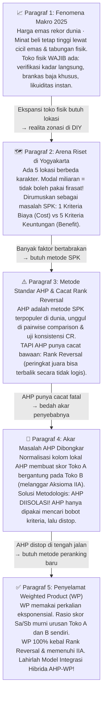
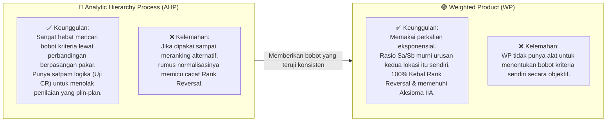
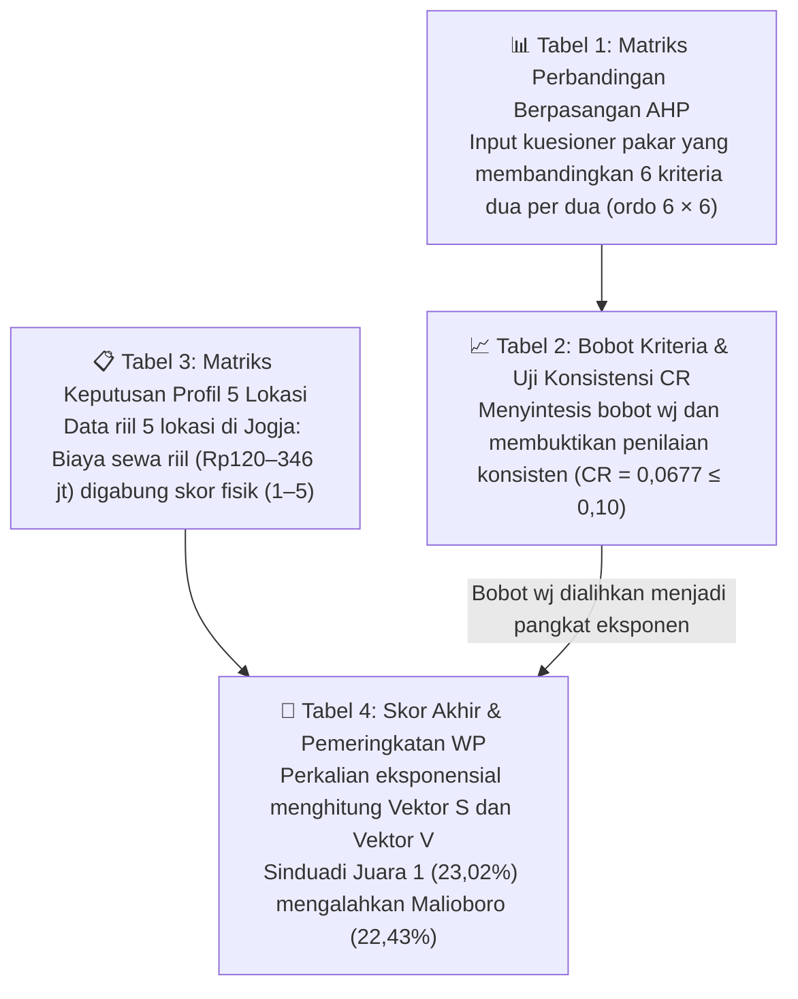
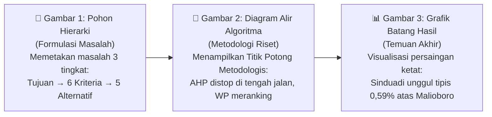
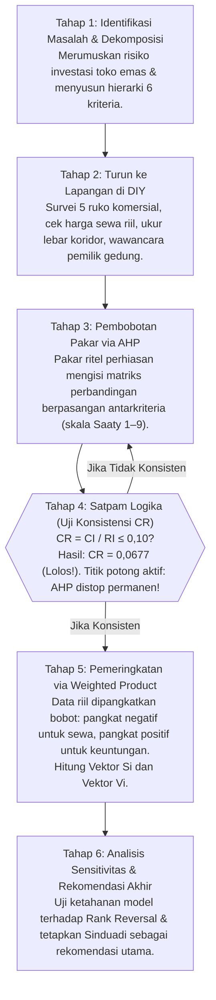
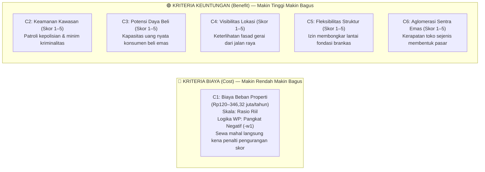
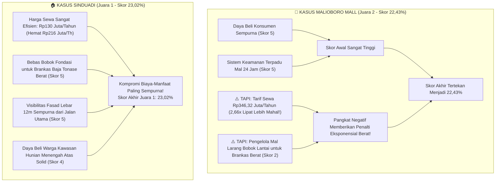

# 📋 RINGKASAN PRESENTASI SPK — 17 November 2026
**Topik Riset:** Penentuan Lokasi Strategis Toko Emas di Yogyakarta Menggunakan Model Hibrida AHP-WP  
**Target Audiens:** Pemula dalam Sistem Pendukung Keputusan (SPK) / Mahasiswa / Praktisi Bisnis  
**Cakupan Materi:** Rangkuman Lengkap Bab A (Pendahuluan) sampai Bab D (Hasil & Pembahasan)

---

## 💡 PENGANTAR: APA ITU SPK DAN MENGAPA KITA BUTUH RISET INI?

### Skenario Masalah di Dunia Nyata
Bayangkan Anda adalah seorang investor yang memiliki modal miliaran rupiah untuk membuka cabang baru gerai ritel perhiasan emas di Daerah Istimewa Yogyakarta. Dalam dunia bisnis ritel, ada ungkapan klasik: *"Lokasi adalah penentu 80% keberhasilan toko fisik."* 

Di Yogyakarta, terdapat 5 kandidat lokasi yang sangat berbeda karakteristiknya:
1. **Malioboro Mall:** Pengunjungnya jutaan orang per tahun dan ada banyak wisatawan berkantong tebal. Namun, tarif sewanya luar biasa mahal (Rp346,32 juta per tahun) dan pengelola mal melarang pembongkaran lantai gedung untuk menanam brankas baja berat.
2. **Sinduadi (Jl. Umbul Permai):** Kawasan hunian mapan di Sleman dengan tarif sewa jauh lebih murah (Rp130 juta per tahun), fasad toko 12 meter menghadap jalan utama, dan pemilik gedung mengizinkan renovasi fondasi brankas baja seberat puluhan ton. Namun, keramaian pejalan kakinya tidak sebanyak mal.
3. **Jalan Magelang:** Koridor komersial arteri regional yang sangat padat dengan sewa termurah (Rp120 juta per tahun), tetapi persaingan toko di koridor tersebut sangat ketat.
4. **Taman Siswa:** Kawasan pusat kota dengan posisi ruko sudut (*hook*) yang sangat strategis, namun harga sewanya cukup tinggi (Rp250 juta per tahun).
5. **Babarsari:** Kawasan mahasiswa yang sangat ramai lalu lintasnya, tetapi mayoritas populasinya adalah mahasiswa yang uang sakunya terbatas.

### Mengapa Keputusan Ini Tidak Boleh Menggunakan "Firasat" (*Feeling*)?
Toko perhiasan emas bukan seperti kedai kopi atau warung makan biasa. Komoditas emas memiliki nilai yang sangat padat (*high value-to-volume density*) dan modal inventori yang tersimpan di etalase mencapai miliaran rupiah. Jika investor salah memilih lokasi:
- Kalau memilih lokasi sepi atau salah target konsumen, biaya sewa ratusan juta tidak akan tertutup oleh keuntungan penjualan.
- Kalau memilih lokasi yang rawan kriminalitas atau gedungnya tidak boleh dipasangi brankas tahan bobol, risikonya adalah perampokan bersenjata.

Oleh karena itu, pengambil keputusan memerlukan **Sistem Pendukung Keputusan (SPK)** atau *Decision Support System (DSS)*. SPK adalah cabang ilmu komputer terapan yang memanfaatkan model matematika untuk menimbang banyak faktor yang saling bertentangan secara rasional, adil, transparan, dan terbebas dari bias emosional manusiawi.

---

## BAGIAN 1 — BAB PENDAHULUAN: LATAR BELAKANG & IDE SOLUSI

### 1.1. Konteks Masalah: Fenomena Emas 2025 dan Kebutuhan Toko Fisik
Pada tahun 2025, ketidakpastian geopolitik global dan pelemahan nilai tukar rupiah mendorong harga emas dunia menembus rekor tertinggi sepanjang sejarah. Menariknya, kenaikan harga ini tidak menurunkan minat masyarakat Indonesia. Justru terjadi pergeseran perilaku: 41,7% masyarakat memilih program cicil emas dan 25% membuka tabungan emas fisik sebagai instrumen lindung nilai (*safe haven*).

Tingginya transaksi ini memaksa jaringan ritel emas untuk berekspansi membuka cabang gerai fisik baru. Mengapa harus toko fisik di era serba digital? Ada 3 alasan mendasar yang tidak bisa digantikan oleh internet:
1. **Verifikasi Fisik Langsung:** Pembeli emas ingin menguji keaslian, menimbang gramasi, dan mengecek kadar karat secara langsung di depan mata.
2. **Kebutuhan Brankas Khusus:** Toko fisik berfungsi sebagai depo penyimpanan aman berstandar perbankan dengan brankas baja tonase berat.
3. **Likuiditas Seketika:** Konsumen yang ingin menjual kembali emasnya (*buyback*) menuntut uang tunai cair saat itu juga tanpa menunggu proses transfer online.

Kebutuhan ekspansi gerai fisik inilah yang menjadi latar belakang perumusan model SPK penentuan lokasi di Yogyakarta.

---

### 1.2. Alur Logika Cerita 5 Paragraf Pendahuluan

Diagram di bawah ini menggambarkan alur pemikiran ilmiah yang dibangun secara runtut dari paragraf 1 sampai paragraf 5 di dalam naskah paper:

---

### 1.3. Penjelasan Rinci Alur 5 Paragraf Pendahuluan

Berikut adalah bedah materi mendalam dari kelima paragraf pendahuluan untuk memandu pemahaman audiens:

1. **Paragraf 1 (Latar Belakang Finansial):**  
   Menjelaskan lonjakan transaksi emas pada tahun 2025 dan membuktikan dengan data bahwa toko fisik tetap menjadi pilar utama transaksi emas yang tidak akan punah tergerus era digital.
2. **Paragraf 2 (Konteks Yogyakarta & Formulasi SPK):**  
   Membawa masalah makro ke arena lokal Daerah Istimewa Yogyakarta. Menjelaskan dilema 5 lokasi komersial dan merumuskannya secara ilmiah sebagai masalah *Multi-Criteria Decision Making* (MCDM) yang mempertemukan 1 atribut biaya (*cost*) melawan 5 atribut keuntungan (*benefit*).
3. **Paragraf 3 (Metode Populer AHP dan Cacat Bawaannya):**  
   Memperkenalkan metode *Analytic Hierarchy Process* (AHP) sebagai metode paling lazim untuk keputusan spasial. Memuji keunggulan AHP dalam membandingkan kriteria secara berpasangan dan kemampuannya menguji konsistensi logika penilai ($CR \le 0{,}10$). Namun, paragraf ini langsung memunculkan *gap* penelitian: AHP memiliki anomali pembalikan peringkat (*rank reversal*).
4. **Paragraf 4 (Bedah Akar Masalah AHP & Keputusan Isolasi):**  
   Menjelaskan penyebab ilmiah mengapa AHP bisa mengalami *rank reversal*. Rumus normalisasi penjumlahan kolom lokal AHP membuat skor suatu alternatif saling terkait dengan alternatif lain, sehingga melanggar aksioma *Independence of Irrelevant Alternatives* (IIA) dari Kenneth Arrow. Peneliti mengambil sikap tegas: AHP diisolasi dan dihentikan hanya sampai tahap bobot kriteria!
5. **Paragraf 5 (Hadirnya WP sebagai Solusi & Tujuan Riset):**  
   Memperkenalkan metode *Weighted Product* (WP) sebagai solusi pengganti untuk pemeringkatan akhir. Karena menggunakan perkalian eksponensial, perbandingan dua alternatif pada WP bersifat mandiri dan kebal 100% dari *rank reversal*. Paragraf ditutup dengan rumusan tujuan riset: membangun model optimasi hibrida AHP-WP yang teruji konsisten, adil, dan stabil.

---

### 1.4. Kamus Istilah Dasar SPK untuk Pemula

Tabel berikut menyederhanakan istilah-istilah teknis kecerdasan buatan dan riset operasi ke dalam bahasa sehari-hari:

| Istilah SPK | Definisi Ilmiah Ringkas | Bahasa Sederhana / Analogi Sehari-hari |
|:---|:---|:---|
| **MCDM (*Multi-Criteria Decision Making*)** | Pengambilan keputusan multikriteria untuk memilih alternatif terbaik berdasarkan beberapa kriteria evaluasi yang saling bertentangan. | Seni memilih keputusan terbaik saat ada banyak faktor yang saling bertabrakan: *"Mau sewa murah tapi agak sepi, atau sewa mahal tapi sangat ramai?"* |
| **Alternatif ($A_i$)** | Objek atau pilihan-pilihan kandidat yang sedang dievaluasi untuk dicari pemenangnya. | 5 pilihan lokasi toko di Yogyakarta: Sinduadi ($A_1$), Jl. Magelang ($A_2$), Babarsari ($A_3$), Taman Siswa ($A_4$), dan Malioboro Mall ($A_5$). |
| **Kriteria Biaya (*Cost*)** | Parameter keputusan di mana **nilai yang semakin kecil memberikan preferensi yang semakin tinggi** (semakin menguntungkan). | Biaya sewa ruko ($C_1$). Tentu saja pemilik modal lebih suka biaya sewa Rp120 juta dibanding Rp346 juta per tahun. |
| **Kriteria Keuntungan (*Benefit*)** | Parameter keputusan di mana **nilai yang semakin besar memberikan preferensi yang semakin tinggi**. | Kriteria $C_2$ sampai $C_6$: Keamanan kawasan, potensi daya beli pengunjung, visibilitas fasad ruko, keleluasaan renovasi brankas, dan klaster sentra emas. |
| **Pembalikan Peringkat (*Rank Reversal*)** | Anomali matematis di mana urutan peringkat alternatif yang sudah ada berubah atau bertukar posisi secara tiba-tiba hanya karena ada alternatif baru yang dimasukkan atau dihapus. | **Penyakit fatal SPK:** Bayangkan Toko A juara 1 dan Toko B juara 2. Lalu kita menambahkan kandidat Toko C yang lokasinya jelek. Tiba-tiba peringkatnya berbalik menjadi Toko B juara 1 dan Toko A juara 2! Ini tidak rasional dan membahayakan modal investor. |
| **Aksioma IIA (*Independence of Irrelevant Alternatives*)** | Prinsip dasar pemilihan rasional: perbandingan antara opsi A dan B seharusnya hanya dipengaruhi oleh performa opsi A dan B sendiri, bukan oleh hadirnya opsi C. | Jika Anda lebih suka makan apel dibanding pisang, hadirnya buah jeruk di atas meja makan tidak boleh membuat Anda tiba-tiba lebih suka pisang dibanding apel! |

---

## BAGIAN 2 — LANDASAN TEORI: PERSAMAAN MATEMATIKA

### 2.1. Arsitektur Hibrida 2 Fase: Pembagian Tugas AHP dan WP
Kunci keunggulan model penelitian ini terletak pada **pembagian wewenang yang tegas (*separation of concerns*)**. Kita tidak mencampuradukkan kedua metode, melainkan memanfaatkan kelebihan terkuat dari masing-masing metode:
- **Tugas AHP:** Menentukan bobot kepentingan kriteria dan memvalidasi apakah logika penilaian pakar konsisten atau tidak ($CR \le 0{,}10$).
- **Tugas WP:** Mengambil bobot yang sudah divalidasi oleh AHP, lalu memeringkat kelima alternatif lokasi menggunakan perkalian eksponensial yang kebal *rank reversal*.

```mermaid
flowchart LR
    subgraph FASE1["🔵 FASE 1: AHP (Khusus Mencari Bobot Kriteria)"]
        A["1. Kuesioner Pakar\nMembandingkan 6 kriteria dua per dua\n(Skala Saaty 1–9)"] --> B["2. Hitung Bobot wj\nNormalisasi kolom lalu rata-rata baris\nTotal akumulasi bobot = 100%"]
        B --> C{{"3. Satpam Logika: Uji CR\nApakah pakar plin-plan?\nCR ≤ 0,10 ?"}}
        C -->|"❌ CR > 0,10 (Plin-plan)"| A
        C -->|"✅ CR ≤ 0,10 (Konsisten)"| D["Bobot Valid!\nContoh: Daya Beli = 46,14%"]
    end

    subgraph CUTOFF["🛑 TITIK POTONG METODOLOGIS"]
        D --> E["AHP DISTOP PERMANEN!\nInstrumen AHP tidak boleh dipakai\nmeranking alternatif lokasi."]
    end

    subgraph FASE2["🟢 FASE 2: WP (Khusus Meranking Alternatif)"]
        E --> F["4. Bobot Jadi Pangkat Eksponen\n+ Bobot untuk Kriteria Keuntungan\n− Bobot untuk Kriteria Biaya Sewa"]
        F --> G["5. Hitung Skor Tiap Toko (Vektor S)\nNilai kriteria dipangkatkan bobot\nlalu DIKALIKAN"]
        G --> H["6. Hitung Persentase Kemenangan (Vektor V)\nSkor toko dibagi total semua skor\n(Total persentase = 100%)"]
        H --> I["🏆 Peringkat Juara Terpilih!\nSinduadi Juara 1 (23,02%)"]
    end
```

---

### 2.2. Kamus Rumus Matematika (Apa Fungsinya Bagi Pengambil Keputusan?)

Model matematika dalam paper ini tidak rumit jika kita memahami fungsi praktis di balik setiap rumusnya:

| Rumus | Nama Rumus & Notasi | Fungsi Praktis dalam Pengambilan Keputusan | Syarat Lulus & Output |
|:---:|:---|:---|:---|
| **Pers. 1** | **Sintesis Bobot Eigen Vector ($w_j$)** | Menghitung berapa persen porsi pentingnya masing-masing kriteria dari matriks perbandingan berpasangan. | Menghasilkan nilai bobot $w_j$ di mana total seluruh bobot kriteria harus pas $\sum w_j = 1{,}0000$ ($100\%$). |
| **Pers. 2a** | **Consistency Index ($CI$)** | Mengukur seberapa jauh deviasi atau penyimpangan penilaian pakar dari konsistensi logika yang sempurna. | Dihitung dari nilai eigen maksimum ($\lambda_{\max}$) dan ukuran matriks ($n$). |
| **Pers. 2b** | **Consistency Ratio ($CR$)** | **"Satpam Logika"**. Membandingkan nilai penyimpangan $CI$ dengan indeks acak standar Saaty ($RI$). Memastikan pakar tidak memberikan penilaian yang bertentangan secara logika. | **Syarat Lulus Mutlak:** Nilai $CR \le 0{,}10$ ($10\%$). Pada riset ini, diperoleh $CR = 0{,}0677$ *(Lolos Valid!)*. |
| **Pers. 3a** | **Penyesuaian Eksponen ($W_j$)** | Mengubah bobot dari AHP menjadi pangkat eksponensial dalam algoritma WP. Kriteria keuntungan diberi tanda positif ($+w_j$), sedangkan kriteria biaya sewa diberi tanda negatif ($-w_j$). | Pangkat negatif secara otomatis memberikan penalti bagi toko yang biaya sewanya mahal. |
| **Pers. 3b** | **Vektor Preferensi Absolut ($S_i$)** | Menghitung skor kekuatan murni masing-masing lokasi dengan mengalikan seluruh nilai kinerja yang telah dipangkatkan bobotnya. | Menghasilkan nilai $S_i$ independen. Semakin besar nilai $S$, semakin tangguh performa lokasi tersebut. |
| **Pers. 4** | **Vektor Preferensi Relatif ($V_i$)** | Menormalisasi nilai $S_i$ terhadap total akumulasi semua lokasi agar berubah menjadi angka persentase yang mudah dipahami manusia. | Nilai $V_i$ terbesar adalah Juara 1. Total seluruh nilai $\sum V_i$ wajib tepat bernilai $1{,}0000$ ($100\%$). |

---

### 2.3. Mengapa AHP dan WP Harus Dikombinasikan? (Analisis Peran)

Diagram berikut menjelaskan mengapa metode tunggal tidak cukup dan mengapa kombinasi keduanya adalah langkah cerdas:

---

## BAGIAN 3 — LANDASAN TEORI: ALUR 4 TABEL KOMPUTASI

### 3.1. Hubungan Antar-Tabel: Dari Kuesioner Mentah Hingga Juara Akhir
Dalam naskah paper, seluruh proses perhitungan disajikan ke dalam 4 tabel terstruktur yang saling menyambung seperti rantai produksi:

---

### 3.2. Penjelasan Lengkap 4 Tabel Manuskrip

Berikut adalah rincian isi, makna angka kunci, dan pesan akademis dari keempat tabel tersebut:

| No. Tabel | Nama Tabel & Ukuran | Apa Saja Datanya? | Angka Kunci & Fakta Menarik | Makna Ilmiah Bagi Audiens |
|:---:|:---|:---|:---|:---|
| **Tabel 1** | **Matriks Pairwise AHP** Ukuran $6 \times 6$ | Penilaian perbandingan berpasangan antar 6 kriteria berdasarkan skala Saaty 1–9. Diagonal bernilai 1. | Total kolom kriteria Potensi Daya Beli ($C_3$) bernilai paling kecil, yaitu **$1{,}9206$**. | Dalam metode AHP, kriteria yang memiliki total kolom paling kecil membuktikan bahwa kriteria tersebut paling sering dinilai lebih penting dibanding kriteria lainnya. |
| **Tabel 2** | **Bobot Prioritas & Uji CR** 6 Kriteria + 5 Parameter Uji | Distribusi persentase kepentingan 6 kriteria beserta nilai eigen maksimum, $CI$, $RI$, dan $CR$. | • **Daya Beli ($C_3$): $46{,}14\%$ (Peringkat 1)** • Visibilitas ($C_4$): $22{,}58\%$ (Peringkat 2) • Biaya Sewa ($C_1$): $13{,}33\%$ (Peringkat 3) • Aglomerasi ($C_6$): $10{,}23\%$ (Peringkat 4) • Keamanan ($C_2$): $5{,}01\%$ (Peringkat 5) • Fleksibilitas Struktur ($C_5$): $2{,}71\%$ (Peringkat 6) • **$CR = 0{,}0677 \le 0{,}10$** | Kriteria Potensi Daya Beli mendominasi hampir separuh bobot ($46{,}14\%$), menegaskan bahwa toko emas bertumpu pada daya beli nyata. Nilai $CR = 0{,}0677$ membuktikan penilaian pakar logis dan bebas dari kontradiksi. |
| **Tabel 3** | **Matriks Keputusan ($X$)** Ukuran $5 \times 6$ | Data profil kinerja empiris 5 kandidat lokasi terhadap 6 kriteria keputusan. | • Sewa termurah: Jl. Magelang (Rp120 jt) • Sewa termahal: Malioboro Mall (Rp346,32 jt) • Daya beli terendah: Babarsari (Skor 2) • Daya beli tertinggi: Malioboro (Skor 5) | Tabel ini menggabungkan data kuantitatif kontinu (biaya sewa ratusan juta rupiah) dengan data kualitatif diskrit (skor 1–5) secara langsung tanpa perlu penyeragaman linier. |
| **Tabel 4** | **Pemeringkatan Akhir WP** 5 Lokasi + Total Akumulasi | Hasil komputasi preferensi absolut Vektor $S_i$, preferensi relatif Vektor $V_i$, dan urutan juara. | • **Peringkat 1: Sinduadi ($V_1 = 0{,}2302$ / $23{,}02\%$)** • Peringkat 2: Malioboro Mall ($V_5 = 0{,}2243$ / $22{,}43\%$) — selisih tipis $0{,}59\%$ • Peringkat 3: Taman Siswa ($V_4 = 0{,}2158$ / $21{,}58\%$) • Peringkat 4: Jl. Magelang ($V_2 = 0{,}1937$ / $19{,}37\%$) • Peringkat 5: Babarsari ($V_3 = 0{,}1360$ / $13{,}60\%$) | Sinduadi dinobatkan sebagai Juara 1 karena menawarkan keseimbangan kompromi terbaik: biaya sewa efisien, visibilitas jalan utama tinggi, dan kebebasan memasang brankas baja tonase berat. |

---

## BAGIAN 4 — LANDASAN TEORI: 3 GAMBAR VISUALISASI

### 4.1. Pemetaan Peran 3 Visualisasi Grafis
Dalam penulisan ilmiah berstandar jurnal, gambar bukan sekadar ilustrasi hiasan, melainkan alat visualisasi bukti metodologis dan hasil analisis:

---

### 4.2. Penjelasan Detail 3 Gambar untuk Presentasi

1. **Gambar 1 — Struktur Hierarki Keputusan (Tipe: Graph TD):**  
   Gambar ini memperlihatkan bagaimana masalah pemilihan lokasi toko emas dipecah menjadi 3 level sistematis. Level 1 adalah sasaran utama (lokasi terbaik). Level 2 adalah 6 kriteria evaluasi (1 biaya vs 5 keuntungan). Level 3 adalah 5 alternatif lokasi di Yogyakarta. Gambar ini memudahkan audiens melihat ruang lingkup persoalan secara menyeluruh hanya dalam sekali pandang.
2. **Gambar 2 — Diagram Alir Algoritma Hibrida AHP-WP (Tipe: Flowchart TD):**  
   Gambar ini menjadi inti arsitektur metodologis paper. Terdapat kotak khusus bergaris putus-putus bernama **Titik Potong Metodologis (*Methodological Cut-off Point*)**. Kotak ini menunjukkan kepada dosen penguji dan audiens momen krusial saat penggunaan AHP dihentikan segera setelah uji $CR \le 0{,}10$ terpenuhi, dan komputasi langsung dialihkan ke perkalian eksponensial WP.
3. **Gambar 3 — Grafik Perbandingan Nilai Preferensi Vektor $V$ (Tipe: XY-Chart / Bar Chart):**  
   Gambar ini menyajikan grafik batang perolehan suara kemenangan kelima lokasi. Dari grafik ini, terlihat jelas betapa sengitnya persaingan antara Sinduadi ($23{,}02\%$) dan Malioboro Mall ($22{,}43\%$). Gambar ini membuktikan secara visual bahwa penalti tarif sewa yang mahal di Malioboro berhasil dimanfaatkan oleh keunggulan efisiensi sewa dan kebebasan brankas berat di Sinduadi.

---

### 4.3. Ketentuan Standar Format Gambar Template Jurnal
Bagi audiens yang ingin memahami standar penerbitan jurnal ilmiah (khususnya template RMSI UIN Suska):
- **Format Warna:** Wajib monokromatis (*grayscale*) hitam-putih dengan pola arsiran yang kontras agar tetap terbaca jelas saat dicetak fisik tanpa warna.
- **Tata Letak Judul:** Judul gambar diletakkan tepat di bagian **bawah gambar**, posisi rata tengah (*center*), menggunakan ukuran huruf 10 pt dalam format *Title Case*.
- **Kaidah Sitasi:** Setiap gambar wajib dipanggil terlebih dahulu di dalam teks paragraf sebelum gambarnya disajikan (misalnya: *"Alur kerja komputasi disajikan pada Gambar 2"*).

---

## BAGIAN 5 — METODOLOGI PENELITIAN: LANGKAH KERJA & PROFIL LOKASI

### 5.1. Alur 6 Tahapan Riset di Lapangan
Bagian Metodologi Penelitian menguraikan langkah demi langkah penyelidikan ilmiah yang dilakukan peneliti secara nyata di lapangan:

---

### 5.2. Profil Mendalam 5 Kandidat Lokasi di Daerah Istimewa Yogyakarta

Peneliti tidak memilih lokasi secara sembarangan, melainkan mengambil 5 sampel yang mewakili variasi zonasi perkotaan di Yogyakarta:

1. **Sinduadi (Jl. Umbul Permai, Sleman) — Alternatif $A_1$:**  
   Merupakan properti komersial mandiri dengan luas 210 meter persegi dan lebar muka 12 meter di kawasan hunian kelas menengah atas. Keunggulan utamanya adalah biaya sewa yang efisien (Rp130 juta/tahun), visibilitas jalan yang sangat terbuka, dan pemilik gedung mengizinkan renovasi fondasi brankas berat. Kekurangannya adalah belum terbentuk klaster toko emas di sekitarnya (skor aglomerasi 2).
2. **Koridor Jalan Magelang Km. 5 (Sleman) — Alternatif $A_2$:**  
   Ruko dua lantai di jalur arteri primer komersial regional dekat Jogja City Mall. Keunggulannya adalah harga sewa paling murah (Rp120 juta/tahun) dan arus lalu lintas kendaraan sangat padat. Namun, persaingan usaha di koridor ini sangat ketat dan daya beli masyarakat sekitar tergolong sedang (skor 3).
3. **Kawasan Babarsari (Caturtunggal, Sleman) — Alternatif $A_3$:**  
   Ruko dua lantai dengan lebar muka 4,2 meter di tengah konsentrasi kampus dan kos-kosan mahasiswa. Mobilitas pengunjung sangat tinggi, namun **profil daya beli masyarakat untuk logam mulia sangat rendah (skor 2)** karena mayoritas populasinya adalah mahasiswa berpenghasilan terbatas.
4. **Jalan Taman Siswa (Mergangsan, Kota Yogyakarta) — Alternatif $A_4$:**  
   Ruko dua lantai yang menempati posisi sudut (*hook*) persimpangan jalan dengan lebar muka mencapai 10 meter. Memberikan aksesibilitas dua arah yang sangat baik dan area parkir memadai. Namun, tarif sewanya cukup mahal, yaitu Rp250 juta per tahun.
5. **Malioboro Mall (Kota Yogyakarta) — Alternatif $A_5$:**  
   Ruang usaha komersial modern seluas 54 meter persegi di dalam pusat perbelanjaan di jantung pariwisata provinsi. Memiliki potensi transaksi dan daya beli pengunjung tertinggi (skor 5), sistem keamanan gedung 24 jam, dan berada di klaster historis pertokoan emas. Namun, **harga sewanya luar biasa mahal (Rp346,32 juta/tahun) dan pengelola mal melarang pembongkaran lantai gedung untuk brankas berat**.

---

### 5.3. Karakteristik Data: 1 Kriteria Biaya vs 5 Kriteria Keuntungan

> [!NOTE]
> **Keunggulan Cerdas Metode Weighted Product:**  
> Pada metode SPK lain (seperti Simple Additive Weighting / SAW), data biaya sewa bernilai ratusan juta rupiah harus diubah terlebih dahulu skalanya agar seragam dengan angka 1 sampai 5. Namun pada **Weighted Product**, data rasio riil biaya sewa dan data ordinal kualitatif 1–5 dapat diolah secara langsung tanpa normalisasi linier di awal, karena sifat perkalian eksponensial secara otomatis menyeimbangkan kontribusi skala pengukuran secara adil!

---

### 5.4. Logika 9 Langkah Komputasi Terstruktur Algoritma Hibrida

Berikut adalah panduan matematis langkah demi langkah bagaimana algoritma integrasi bekerja:

1. **Langkah 1 (Matriks Pairwise AHP):** Menyusun matriks perbandingan berpasangan kriteria $A = [a_{jk}]_{6 \times 6}$ berdasarkan preferensi pakar (skala Saaty 1–9) dengan sifat resiprokal $a_{kj} = 1 / a_{jk}$.
2. **Langkah 2 (Normalisasi Matriks Kolom):** Membagi setiap elemen matriks dengan total nilai kolomnya masing-masing ($r_{jk} = a_{jk} / \sum a_{pk}$).
3. **Langkah 3 (Sintesis Vektor Bobot $w_j$):** Menghitung rata-rata baris matriks ternormalisasi untuk menghasilkan bobot kriteria ($w_j = \frac{1}{n} \sum r_{jk}$) dengan jumlah total bobot tepat bernilai 1.
4. **Langkah 4 (Uji Konsistensi Saaty):** Menghitung nilai eigen terbesar ($\lambda_{\max}$), indeks konsistensi ($CI$), dan rasio konsistensi ($CR = CI / RI$). Memastikan $CR \le 0{,}10$.
5. **Langkah 5 (Titik Potong Metodologis):** Segera setelah $CR$ dinyatakan lolos, operasional instrumen AHP dihentikan secara permanen untuk memutus rantai interdependensi alternatif.
6. **Langkah 6 (Penyesuaian Eksponen WP):** Mengubah tanda bobot: $W_1 = -w_1$ untuk kriteria biaya sewa, dan $W_2$ sampai $W_6 = +w_j$ untuk kelima kriteria keuntungan.
7. **Langkah 7 (Penyusunan Matriks Keputusan $X$):** Menata data kinerja empiris kelima lokasi ke dalam matriks $X = [x_{ij}]_{5 \times 6}$.
8. **Langkah 8 (Komputasi Preferensi Absolut Vektor $S_i$):** Menghitung skor independen masing-masing lokasi melalui perkalian nilai kinerja berpangkat bobot ($S_i = \prod (x_{ij})^{W_j}$).
9. **Langkah 9 (Komputasi Preferensi Relatif Vektor $V_i$):** Menghitung persentase kemenangan masing-masing lokasi ($V_i = S_i / \sum S_k$). Nilai $V_i$ tertinggi dinobatkan sebagai Juara 1 rekomendasi investasi.

---

## BAGIAN 6 — BAB HASIL DAN PEMBAHASAN: SIAPA JUARA & MENGAPA?

### 6.1. Hasil Akhir Pemeringkatan 5 Lokasi di D.I. Yogyakarta

Berikut adalah hasil akhir perhitungan komputasi model hibrida AHP-WP yang menentukan urutan prioritas rekomendasi lokasi pembukaan gerai ritel perhiasan emas:

| Peringkat | Kode Lokasi | Nama Kandidat Lokasi | Nilai Vektor $S_i$ (Skor Absolut) | Nilai Vektor $V_i$ (Persentase Kemenangan) | Status Rekomendasi Keputusan |
|:---:|:---:|:---|:---:|:---:|:---|
| 🥇 **1** | **$A_1$** | **Sinduadi (Jl. Umbul Permai)** | **1,6934** | **0,2302 (23,02%)** | **PRIORITAS UTAMA INVESTASI (JUARA 1)** |
| 🥈 **2** | $A_5$ | Malioboro Mall | 1,6501 | 0,2243 (22,43%) | Alternatif Cadangan 1 (Kalah Tipis 0,59%) |
| 🥉 **3** | $A_4$ | Jalan Taman Siswa | 1,5872 | 0,2158 (21,58%) | Alternatif Cadangan 2 |
| 4 | $A_2$ | Koridor Jalan Magelang Km. 5 | 1,4246 | 0,1937 (19,37%) | Alternatif Cadangan 3 |
| 5 | $A_3$ | Kawasan Babarsari | 1,0006 | 0,1360 (13,60%) | Gugur (Tidak Direkomendasikan) |
| **Total** | - | **Akumulasi Seluruh Kandidat** | **7,3559** | **1,0000 (100,00%)** | - |

---

### 6.2. Mengapa Sinduadi ($A_1$) Bisa Mengalahkan Malioboro Mall ($A_5$)?

Ini adalah temuan inti riset yang menjawab tuntas rumusan masalah pada bagian pendahuluan:

#### Pembahasan Analitis:
1. **Daya Beli vs Beban Sewa:**  
   Malioboro Mall memang unggul mutlak pada potensi transaksi wisatawan ($C_3 = 5$). Namun, keunggulan tersebut harus dibayar sangat mahal dengan tarif sewa Rp346,32 juta per tahun. Karena biaya sewa bertindak sebagai kriteria biaya (*cost*), rumus Weighted Product memangkatkan nilai sewa dengan eksponen negatif ($(346{,}32)^{-0{,}1333} = 0{,}4600$). Angka ini jauh lebih kecil dibandingkan faktor pengali sewa Sinduadi ($(130{,}00)^{-0{,}1333} = 0{,}5244$). Beban sewa Malioboro memangkas skor akhirnya secara drastis.
2. **Keleluasaan Struktur Brankas Fisik:**  
   Toko di dalam pusat perbelanjaan terikat aturan manajemen gedung yang melarang pengeboran lantai fondasi ($C_5 = 2$). Padahal toko emas wajib memiliki brankas baja tonase berat dengan angkur tanam agar tidak bisa diangkat atau dibobol maling. Sebaliknya, ruko mandiri di Sinduadi memberikan kebebasan modifikasi penuh ($C_5 = 5$).
3. **Kesimpulan Kemenangan:**  
   Kombinasi efisiensi biaya sewa yang hemat Rp216 juta per tahun, kebebasan memasang brankas berat, dan visibilitas fasad 12 meter membuat Sinduadi keluar sebagai pemenang dengan keunggulan tipis $0{,}59\%$ atas Malioboro Mall.

---

### 6.3. Mengapa Babarsari Berada di Posisi Juru Kunci?
- Kawasan Babarsari sangat ramai oleh kendaraan dan mahasiswa. Tetapi mengapa Babarsari justru berada di peringkat terbawah dengan skor tertinggal jauh ($13{,}60\%$)?
- **Jawabannya:** Karena komoditas yang dijual adalah **perhiasan emas bernilai jutaan rupiah**, bukan makanan cepat saji atau kopi kekinian! 
- Mayoritas populasi Babarsari adalah mahasiswa yang memiliki kapasitas keuangan terbatas. Kriteria potensi daya beli Babarsari hanya mendapatkan skor 2. Karena daya beli merupakan kriteria paling berbobot dalam model ini ($46{,}14\%$), rendahnya skor daya beli langsung menenggelamkan posisi Babarsari ke posisi juru kunci.
- **Pesan Ilmiah Bagi Praktisi:** *"Lokasi yang ramai belum tentu menguntungkan jika profil lalu lintas pengunjungnya tidak memiliki daya beli yang sesuai dengan produk yang kita jual."*

---

### 6.4. Bukti Ilmiah: Mengapa Model Ini 100% Kebal dari Penyakit *Rank Reversal*?

Untuk membuktikan bahwa sistem keputusan ini stabil dan memenuhi aksioma *Independence of Irrelevant Alternatives* (IIA), mari kita telaah perbandingan aljabar antara dua kandidat teratas:

Rasio preferensi antara Sinduadi ($S_1$) dan Malioboro ($S_5$):
$$\frac{S_1}{S_5} = \frac{1{,}6934}{1{,}6501} = \mathbf{1{,}0262} \quad (\text{selalu lebih besar dari } 1)$$

Berdasarkan rumus perkalian eksponensial Weighted Product:
$$\frac{S_1}{S_5} = \prod_{j=1}^6 \left( \frac{\text{Nilai Sinduadi}_j}{\text{Nilai Malioboro}_j} \right)^{W_j}$$

> **Makna Sederhananya Bagi Audiens:**  
> Perhatikan bahwa rumus pembagian di atas murni hanya membandingkan performa Sinduadi dibagi performa Malioboro.  
> Tidak ada satupun variabel dari Babarsari, Taman Siswa, atau kandidat ruko baru lainnya yang terlibat dalam rumus ini!  
> Artinya: jika investor memutuskan untuk menambah 10 ruko baru ke dalam daftar evaluasi, atau mencoret Babarsari dari daftar, nilai rasio perbandingan $1{,}0262$ ini **tidak akan pernah bergeser sedikit pun!** Sinduadi akan selalu menang atas Malioboro Mall. Inilah bukti otentik bahwa model hibrida AHP-WP terbebas secara mutlak dari cacat *rank reversal*.

---

### 6.5. Kepatuhan Standar Penulisan Daftar Pustaka IEEE

Manuskrip paper ini didukung oleh **12 sumber pustaka standar IEEE** yang memenuhi seluruh kriteria ketat jurnal ilmiah terindeks:

| Parameter Kepatuhan | Standar Ketentuan Jurnal | Realisasi pada Manuskrip | Status Evaluasi |
|:---|:---|:---|:---:|
| **Rentang Waktu Terbitan** | Minimal 80% berasal dari 10 tahun terakhir | **100% pustaka terbitan 2020–2026** (12 dari 12 pustaka) | ✅ *Sangat Mutakhir* |
| **Jenis Sumber Pustaka** | Minimal 80% berupa artikel jurnal ilmiah/konferensi | **91,7% berupa artikel jurnal bereputasi** (11 dari 12 pustaka) | ✅ *Sangat Baik* |
| **Pustaka Non-Jurnal (Tesis/Buku)** | Maksimal 20% dari seluruh jumlah pustaka | **8,3% berupa tesis magister UGM** (1 dari 12 pustaka) | ✅ *Sesuai Syarat* |
| **Materi Web Lepas / Blog Bebas** | Sangat tidak disarankan (0%) | **0% materi web** (nihil rujukan URL bebas) | ✅ *Sempurna* |
| **Bentuk Penulisan Sitasi** | Format IEEE numerik berurutan sesuai kemunculan | Sitasi [1] sampai [12] tersusun berurutan dari Bab A sampai Bab D | ✅ *Sesuai Standar* |
